<div align="center">

# 🛍️ AWS Retail Store DevOps Platform
### Cloud-Native Microservices, Kubernetes (K3s), AWS Infrastructure & Python SRE Automation

[](https://github.com/ranjeetkumarguptabro-maker/retail-store-devops/actions/workflows/ci.yml)
[](https://github.com/ranjeetkumarguptabro-maker/retail-store-devops/actions/workflows/security.yml)
[](https://github.com/ranjeetkumarguptabro-maker/retail-store-devops/actions/workflows/deploy.yml)
[](kubernetes/)
[](terraform/)
[](automation/)
[](automation/tests/)
[](application/LICENSE)

<p align="center">
  <b>A hands-on DevOps, Cloud Infrastructure, and Site Reliability Engineering (SRE) implementation for polyglot microservices on AWS, Kubernetes (K3s), Terraform, Prometheus, Grafana, and Python automation.</b>
</p>

<p align="center">
  I built this project to take a multi-language retail application (Java, Go, and Node.js) all the way from local source code to a live, monitored Kubernetes cluster on AWS.<br/>
  Everything from Terraform infrastructure and Amazon ECR container builds to automated GitHub Actions CI/CD and Trivy security checks runs end to end.<br/>
  On top of the deployment, I configured Prometheus, Grafana, AWS CloudWatch, and a custom Python SRE engine to continuously monitor health, track SLOs, and catch issues early.
</p>

[Architecture](#1-high-level-cloud-architecture) •
[AWS VPC](#2-aws-cloud-architecture--multi-account-vpc-topology) •
[DevOps Loop](#3-enterprise-devops-infinity-loop-blueprint) •
[Live Screenshots](#-live-deployment--cloud-verification-screenshots) •
[Project Structure](#-project-structure) •
[Run Locally](#-run-locally) •
[Security](#-security-practices)

---

</div>

## 1. High-Level Cloud Architecture

<div align="center">
  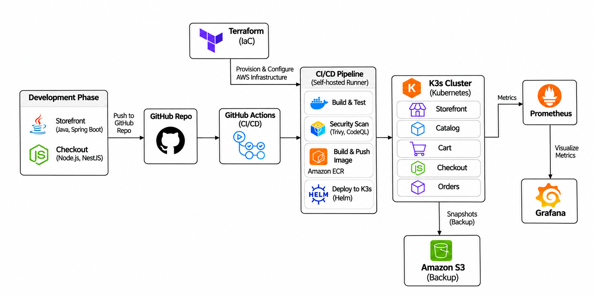
  <p><i>End-to-End Retail Store DevOps Architecture — Development Phase, Terraform Infrastructure as Code, GitHub Actions CI/CD (Build &amp; Test, Trivy Security Scan, Amazon ECR Push, Helm Deploy), K3s Kubernetes Microservices Cluster, Amazon S3 Backup, and Prometheus/Grafana Observability.</i></p>
</div>

---

### 2. AWS Cloud Architecture & Multi-Account VPC Topology
<div align="center">
  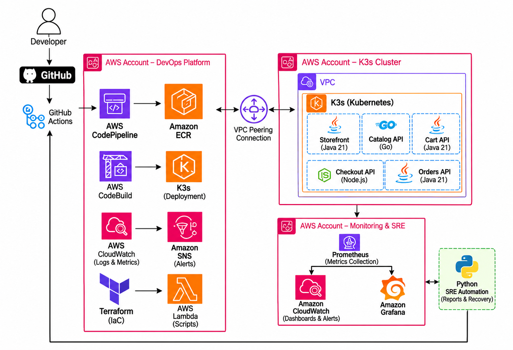
  <p><i>Enterprise Multi-Account AWS Architecture — DevOps Platform Account, VPC Peering, AWS K3s Cluster Account (VPC &amp; 5 Polyglot Microservices), Dedicated Monitoring &amp; SRE Account (Prometheus, CloudWatch, Grafana), and Python SRE Automation Engine.</i></p>
</div>

---

### 3. Enterprise DevOps Infinity Loop Blueprint
<div align="center">
  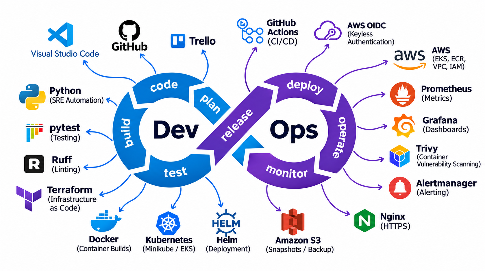
  <p><i>Enterprise DevOps Infinity Loop Blueprint — Continuous Planning &amp; Development (VS Code, GitHub, Python, Ruff, Pytest), Infrastructure &amp; Container Delivery (Terraform, Docker, Kubernetes, Helm), Cloud Deployment (AWS OIDC, Kubernetes, S3), and SRE Observability (Prometheus, Grafana, Trivy, Alertmanager).</i></p>
</div>

---

## 📸 Live Deployment & Cloud Verification Screenshots

End-to-end visual proof captured directly from the live AWS (`eu-north-1`), Kubernetes (K3s), Amazon ECR, GitHub Actions, Prometheus, Grafana, and AWS CloudWatch deployment.

### A. Infrastructure as Code & AWS Cloud Provisioning (`eu-north-1`)

#### 1. Modular Terraform Workspace & Validation
<div align="center">
  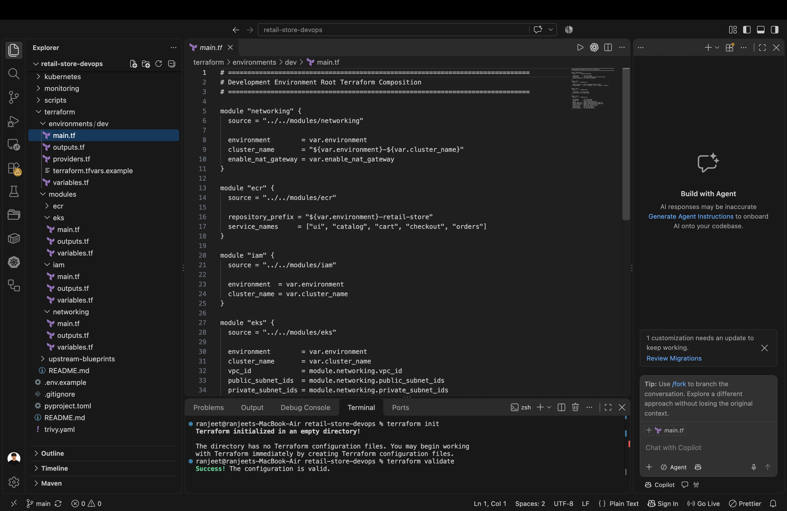
  <p><i>Modular Terraform IaC composition (<code>networking</code>, <code>ecr</code>, <code>iam</code>, <code>eks</code>) with <code>terraform validate</code> passing cleanly.</i></p>
</div>

#### 2. AWS EC2 Kubernetes Host (`retail-store-k3s-server`)
<div align="center">
  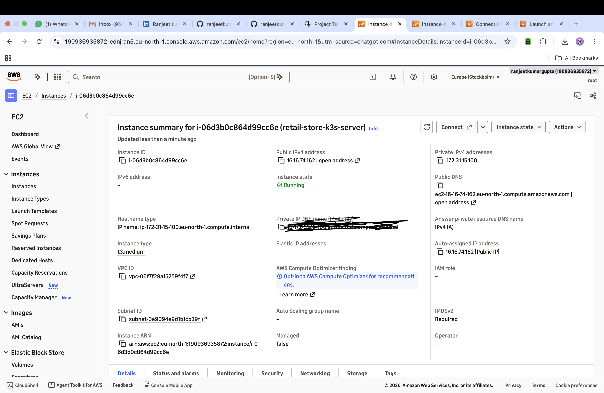
  <p><i>AWS EC2 <code>t3.medium</code> instance running in Europe (Stockholm) <code>eu-north-1</code> with IMDSv2 enforced.</i></p>
</div>

#### 3. AWS EC2 Security Group Inbound Rules
<div align="center">
  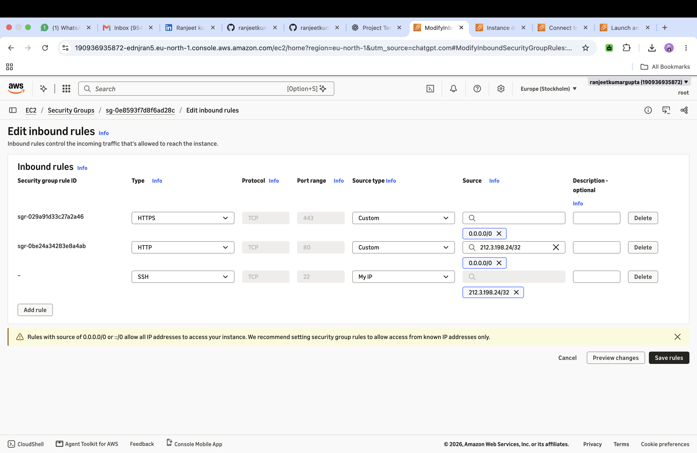
  <p><i>Hardened inbound security group rules allowing HTTPS (443) and HTTP (80) web traffic with SSH (22) locked down to administrator IP.</i></p>
</div>

#### 4. AWS IAM Least-Privilege Role (`AmazonEC2ContainerRegistryReadOnly`)
<div align="center">
  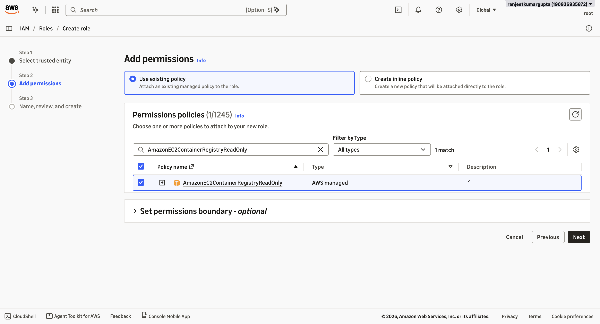
  <p><i>Least-privilege IAM role configuration granting read-only access to Amazon ECR repositories.</i></p>
</div>

---

### B. Kubernetes Cluster, Amazon ECR & Live Storefront Deployment

#### 5. K3s Kubernetes Cluster Bootstrap
<div align="center">
  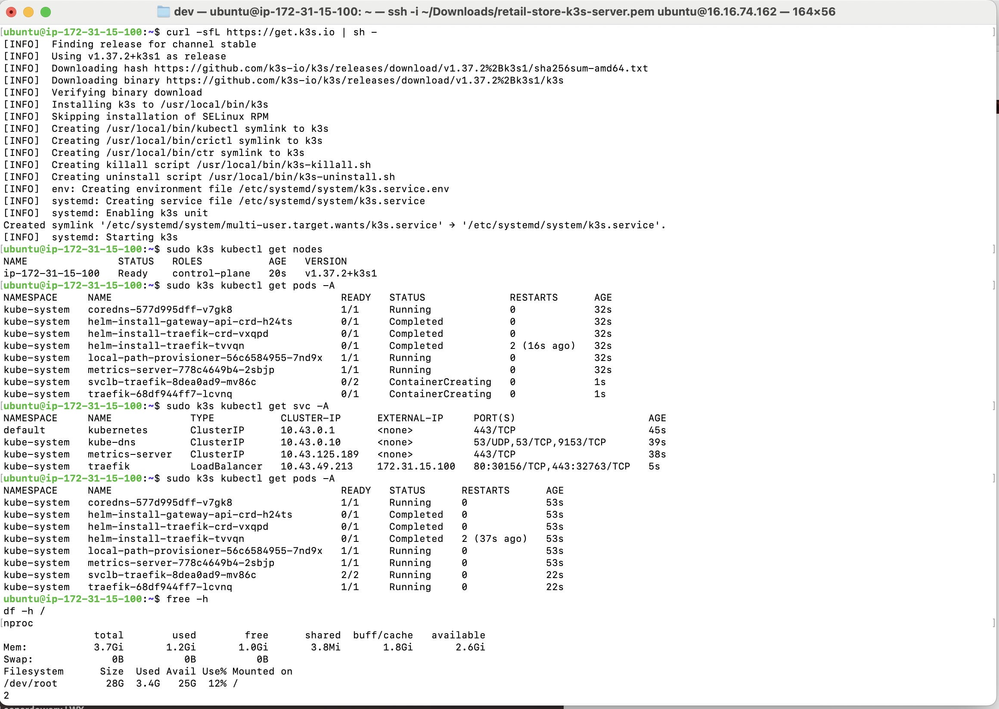
  <p><i>K3s cluster (<code>v1.37.2+k3s1</code>) initialized on EC2 with CoreDNS, Metrics Server, Local Path Provisioner, and Traefik Ingress Controller running.</i></p>
</div>

#### 6. All 5 Microservice Images Pushed to Amazon ECR
<div align="center">
  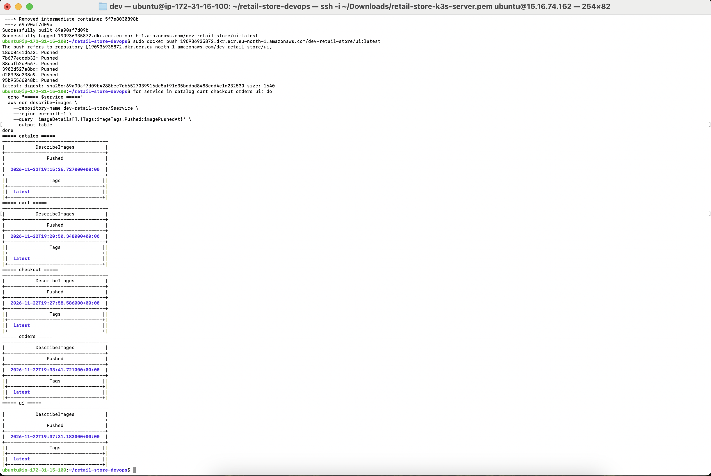
  <p><i>All five polyglot microservice images (<code>catalog</code>, <code>cart</code>, <code>checkout</code>, <code>orders</code>, <code>ui</code>) built and verified in Amazon ECR (<code>eu-north-1</code>).</i></p>
</div>

#### 7. Microservices & Traefik Ingress Running in `retail-store` Namespace
<div align="center">
  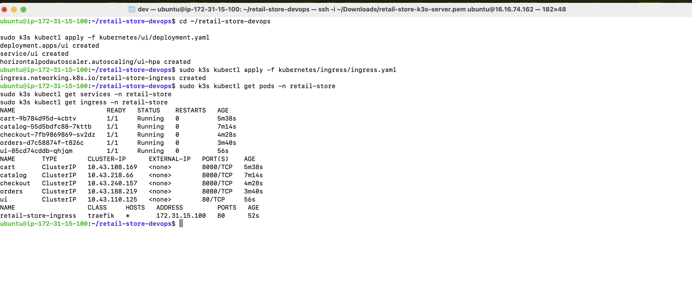
  <p><i>All 5 microservice pods (<code>1/1 Running</code>, <code>0 restarts</code>), ClusterIP services, HPA, and Traefik Ingress deployed in the <code>retail-store</code> namespace.</i></p>
</div>

#### 8. Live AWS Retail Storefront Web Application
<div align="center">
  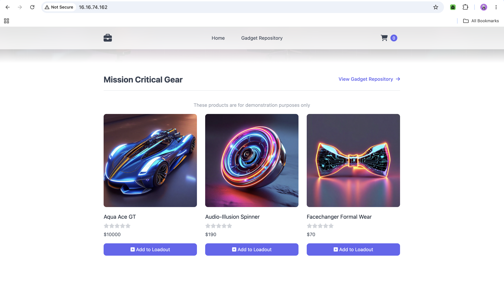
  <p><i>Live Retail Storefront UI served from AWS EC2/K3s rendering the dynamic product catalog and shopping cart mesh.</i></p>
</div>

---

### C. Enterprise CI/CD Pipeline Verification

#### 9. Live GitHub Actions CI/CD Workflows (All Green)
<div align="center">
  
  <p><i>Live GitHub Actions runs on branch <code>main</code> — Security Scan &amp; Compliance, Continuous Deployment, and Continuous Integration all passing.</i></p>
</div>

---

### D. Production Observability: Prometheus, Grafana, SRE Engine & AWS CloudWatch

#### 10. Prometheus Microservice Actuator Targets (`UP`)
<div align="center">
  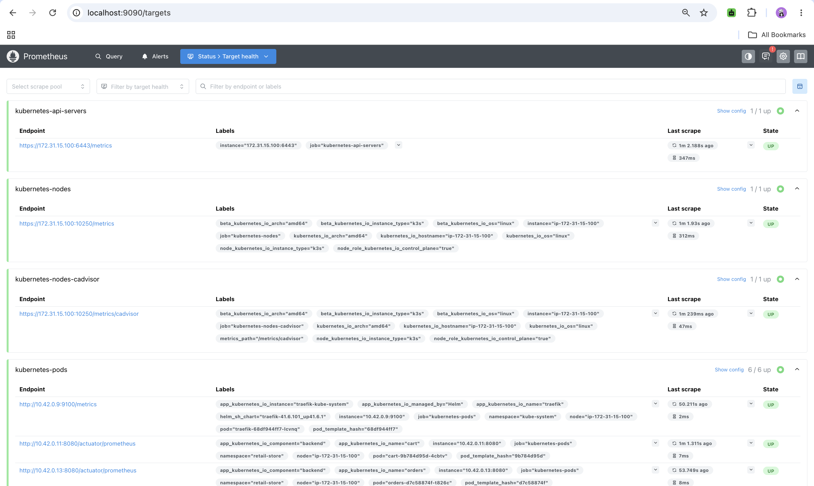
  <p><i>Prometheus actively scraping Kubernetes API server, nodes, cAdvisor, and Spring Boot <code>/actuator/prometheus</code> endpoints for <code>cart</code> and <code>orders</code> pods in state <code>UP</code>.</i></p>
</div>

#### 11. Grafana — Application Overview & 30-Day Availability SLO
<div align="center">
  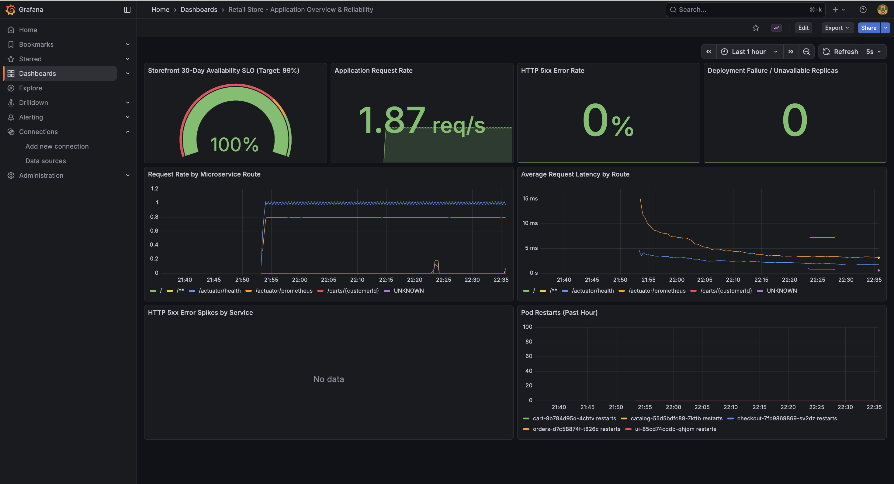
  <p><i>Live Grafana Application Overview tracking <b>100%</b> 30-day availability SLO (target 99%), 1.87 req/s throughput, 0% HTTP 5xx error rate, route latency, and 0 pod restarts.</i></p>
</div>

#### 12. Grafana — Kubernetes Cluster Overview
<div align="center">
  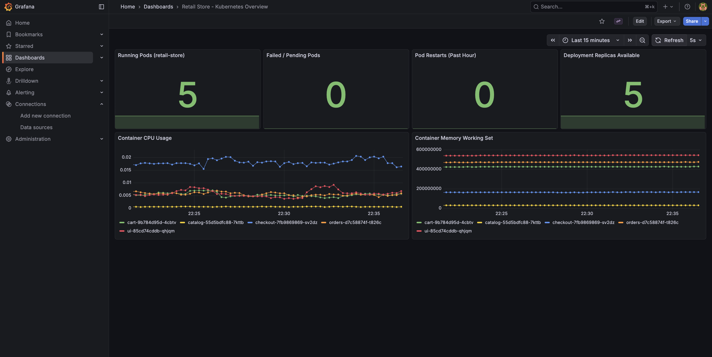
  <p><i>Live Grafana Kubernetes Overview confirming 5/5 running pods, 0 failed/pending pods, 0 restarts, and real-time container CPU and memory usage.</i></p>
</div>

#### 13. Grafana — Infrastructure Capacity Overview
<div align="center">
  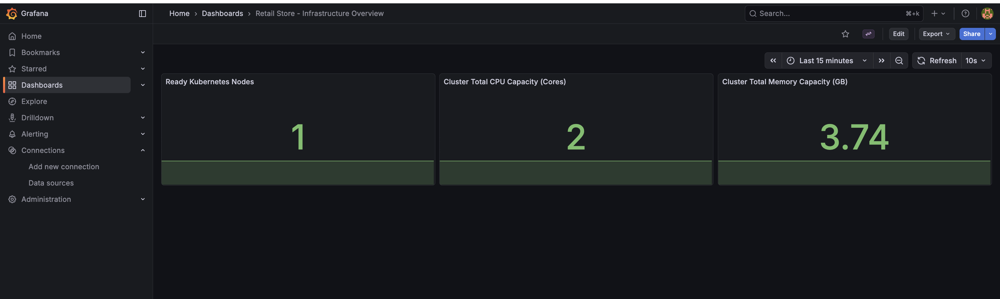
  <p><i>Live Grafana Infrastructure Overview displaying ready Kubernetes nodes, cluster CPU cores, and total memory capacity.</i></p>
</div>

#### 14. Grafana — Python SRE Platform Operations Automation Engine
<div align="center">
  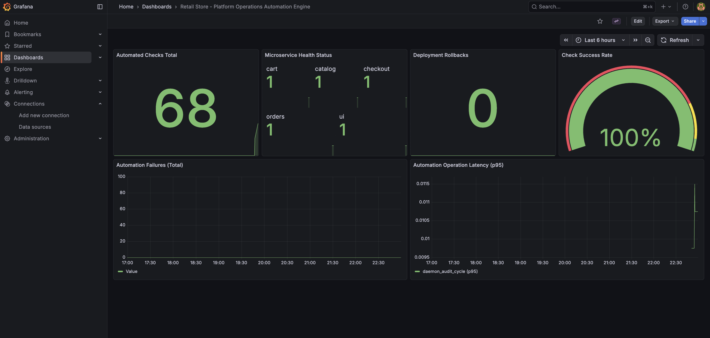
  <p><i>Live Grafana dashboard for the custom Python SRE Operations Automation Engine showing 68 automated health checks, all 5 microservices healthy, 0 rollbacks, 100% check success rate, and p95 audit latency.</i></p>
</div>

#### 15. AWS CloudWatch Infrastructure Telemetry (`eu-north-1`)
<div align="center">
  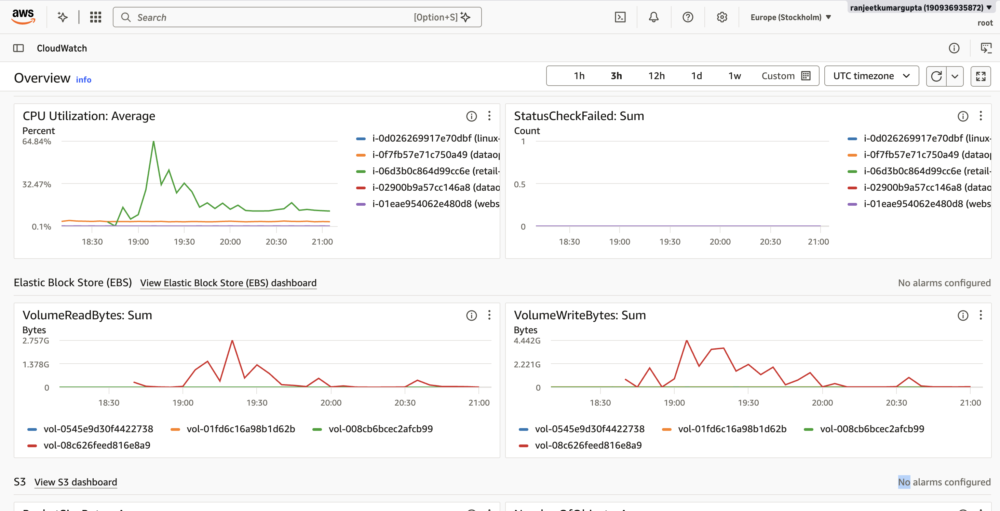
  <p><i>Live AWS CloudWatch overview monitoring EC2 CPU utilization, zero failed status checks, and EBS read/write I/O throughput in Stockholm (<code>eu-north-1</code>).</i></p>
</div>

---

## 📁 Project Structure

```text
retail-store-devops/
│
├── .github/
│   └── workflows/       # GitHub Actions CI, Security (Trivy/SBOM), and CD workflows
│
├── application/         # Upstream AWS Retail Store microservices (Java, Go, Node.js)
├── automation/          # Python SRE operations engine, Prometheus exporter & pytest suite
├── docker/              # Multi-stage Dockerfiles and Docker Compose orchestration
├── docs/
│   └── images/          # Architecture diagrams and live AWS/K8s/Grafana screenshots
├── kubernetes/          # Declarative Kubernetes manifests (Deployments, HPA, PDB, NetworkPolicies)
├── monitoring/          # Prometheus Helm values, alert rules, SLOs, and Grafana dashboards
├── scripts/             # Helper and integration testing scripts
├── terraform/           # Modular AWS IaC (networking, iam, ecr, eks) & dev environment
│
├── pyproject.toml       # Python project and pytest configuration
├── trivy.yaml           # Trivy security scanner configuration
├── .env.example         # Sample environment variables
└── README.md
```

---

## 🚀 Run Locally

### Clone the repository
```bash
git clone https://github.com/ranjeetkumarguptabro-maker/retail-store-devops.git
cd retail-store-devops
```

### Create a Python virtual environment
```bash
python3 -m venv .venv
source .venv/bin/activate
```

### Install Python automation dependencies
```bash
python -m pip install --upgrade pip
python -m pip install -r automation/requirements.txt pytest ruff
```

### Run code quality checks
```bash
ruff check automation/
```

### Run automated unit tests (45 tests)
```bash
python -m pytest automation/tests -m "not integration" -v
```

### Start all 5 microservices with Docker Compose
```bash
docker compose -f docker/docker-compose.yml config
docker compose -f docker/docker-compose.yml up -d
docker compose -f docker/docker-compose.yml ps
```

Open the live storefront in your browser at `http://localhost:8888`.

### Run SRE operations CLI checks
```bash
python3 automation/ops_cli.py diagnose -n retail-store
python3 automation/ops_cli.py verify-deployment -n retail-store
python3 automation/ops_cli.py export-metrics --port 9102 --interval 15
```

### Stop services
```bash
docker compose -f docker/docker-compose.yml down
```
> Avoid `docker compose down -v` unless you intentionally want to delete named volumes and their persistent data.

---

## 🔒 Security Practices

- Least-privilege IAM instance roles (`AmazonEC2ContainerRegistryReadOnly`) instead of permanent AWS access keys.
- EC2 Instance Metadata Service v2 (IMDSv2) enforced.
- Restricted SSH (port 22) access locked down to administrator IP only.
- Kubernetes default-deny NetworkPolicies, ResourceQuotas, and LimitRanges for namespace isolation.
- Automated Trivy vulnerability scanning, secret detection, and CycloneDX SBOM generation in GitHub Actions.
- Multi-stage Dockerfiles running containers as non-root users (`UID: 1000`).
- No private keys, passwords, or secret tokens committed to GitHub.

---

## 🎯 Project Learning Outcomes

This project demonstrates practical experience with:

- Polyglot microservice builds and containerization (Java 21 Spring Boot, Go Gin, Node.js NestJS).
- Python SRE operations automation, Prometheus metrics exporting, and `pytest` unit/integration testing.
- Git and GitHub Actions CI/CD pipelines with Trivy security gates and CycloneDX SBOMs.
- Docker and Docker Compose multi-service orchestration.
- Modular Terraform Infrastructure as Code (`networking`, `iam`, `ecr`, `eks`).
- AWS EC2, VPC, Security Groups, IAM roles, Amazon ECR, and CloudWatch telemetry.
- K3s Kubernetes cluster administration, Traefik Ingress, HPA, and PDBs.
- Production observability with Prometheus scrape targets, 30-day SLO tracking, and Grafana dashboards.

---

## 👨‍💻 Project Repository

**Retail Store DevOps**

GitHub: https://github.com/ranjeetkumarguptabro-maker/retail-store-devops

A hands-on DevOps and cloud platform engineering project focused on polyglot microservices deployment, Kubernetes orchestration, Infrastructure as Code, observability, and Python SRE automation.

*(Upstream AWS Retail Store Sample Application in [`application/`](application/) is licensed under [MIT-0](application/LICENSE).)*
