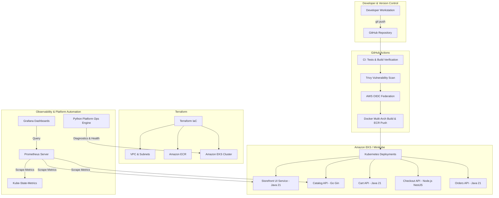

# AWS Retail Store Sample App — End-to-End DevOps & Platform Engineering

[](https://github.com/ranjeetkumarguptabro-maker/retail-store-devops/actions/workflows/ci.yml)
[](https://github.com/ranjeetkumarguptabro-maker/retail-store-devops/actions/workflows/security.yml)
[](LICENSE)

A production-inspired, end-to-end DevOps and Cloud Platform deployment pipeline for the **AWS Retail Store Sample Application** (`aws-containers/retail-store-sample-app`), built around Git, Docker, Kubernetes (Minikube & Amazon EKS), Terraform IaC, GitHub Actions CI/CD with AWS OIDC, Trivy security scanning, Prometheus, Grafana, and custom Python operational automation.

---

## 1. High-Level Architecture



---

## 2. Technology Stack

| Technology | Purpose | Implementation Details |
|---|---|---|
| **AWS Retail Store App** | Target Application | Polyglot microservices: Java (Spring Boot), Go (Gin), Node.js (NestJS) |
| **Git & GitHub** | Source Control | Semantic commits, branch protection, code review workflows |
| **Docker** | Containerization | Multi-stage, non-root (`appuser: 1000`), multi-arch (ARM64 & AMD64) |
| **Kubernetes** | Orchestration | Rolling updates, readiness/liveness probes, HPA, resource requests/limits |
| **Amazon EKS** | Managed K8s | Managed node groups, VPC CNI, cluster security groups |
| **Terraform** | Infrastructure as Code | Modular design (`networking`, `iam`, `ecr`, `eks`), least-privilege IAM |
| **GitHub Actions** | CI/CD Automation | Workflows for testing, Trivy CVE scanning, AWS OIDC deployment |
| **Trivy** | Container Security | Automated image & filesystem scanning for `CRITICAL` and `HIGH` CVEs |
| **Prometheus** | Metrics Collection | Scrapes Spring Boot Actuator (`/actuator/prometheus`) and Gin (`/metrics`) |
| **Grafana** | Dashboards | Application Overview, Kubernetes Overview, Infrastructure Overview |
| **Python** | Platform Automation | Diagnostic engine detecting CrashLoopBackOff, node readiness, rollout health |
| **Pytest / Unittest** | Automation Testing | Unit test suite with mocks validating failure detection logic |

---

## 3. Repository Structure

```text
retail-store-devops/
│
├── application/                     # Original application source code
│   └── src/                         # microservices: ui, catalog, cart, checkout, orders
│
├── docker/
│   ├── docker-compose.yml           # Unified local multi-service orchestration
│   └── .dockerignore
│
├── kubernetes/                      # Production Kubernetes manifests
│   ├── namespace.yaml               # Dedicated retail-store namespace
│   ├── config/                      # ConfigMaps and Secret templates
│   ├── ui/                          # Frontend Deployment, Service, HPA
│   ├── catalog/                     # Catalog Go API Deployment & Service
│   ├── cart/                        # Cart Java API Deployment & Service
│   ├── checkout/                    # Checkout NestJS API Deployment & Service
│   ├── orders/                      # Orders Java API Deployment & Service
│   └── ingress/                     # AWS ALB Ingress configuration
│
├── terraform/                       # Modular AWS Infrastructure as Code
│   ├── modules/
│   │   ├── networking/              # VPC, public & private subnets, NAT, IGW
│   │   ├── iam/                     # Cluster & worker node IAM roles
│   │   ├── ecr/                     # ECR repositories with lifecycle cleanup
│   │   └── eks/                     # EKS cluster & managed node groups
│   └── environments/dev/            # Dev environment composition
│
├── .github/workflows/               # GitHub Actions CI/CD
│   ├── ci.yml                       # Multi-service build & unit tests
│   ├── security.yml                 # Trivy container & filesystem scanning
│   └── deploy.yml                   # AWS OIDC authentication & EKS deployment
│
├── monitoring/                      # Observability stack
│   ├── prometheus/values.yaml       # Prometheus Helm scrape configurations
│   └── grafana/dashboards/          # Application, Kubernetes & Infra dashboards
│
├── automation/                      # Python Platform Operations Automation Engine
│   ├── cluster_health.py            # Node readiness & API connectivity check
│   ├── pod_health.py                # CrashLoopBackOff & restart detector
│   ├── deployment_check.py          # Replica health and availability validator
│   ├── rollout_validator.py         # Release rollout progression checker
│   ├── generate_report.py           # Master structured JSON health reporter
│   ├── requirements.txt
│   └── tests/test_automation.py     # Unit tests for automation engine
│
├── docs/                            # Comprehensive engineering documentation
│   ├── SOURCE_CODE_AUDIT.md         # Stage 0: Codebase audit & architecture report
│   ├── LOCAL_SETUP.md               # Stage 1: Local setup & testing runbook
│   ├── DOCKER.md                    # Stage 2: Containerization & compose guide
│   ├── KUBERNETES_EKS.md            # Stage 3 & 5: Kubernetes & EKS runbook
│   ├── TERRAFORM_AWS.md             # Stage 4: AWS IaC & cost analysis
│   ├── ECR.md                       # Stage 5: ECR registry & multi-arch builds
│   ├── GITHUB_ACTIONS_CICD.md       # Stage 6: CI/CD & Trivy scanning guide
│   ├── PROMETHEUS.md                # Stage 7: Prometheus metrics scraping
│   ├── GRAFANA.md                   # Stage 8: Grafana operational dashboards
│   ├── PYTHON_AUTOMATION.md         # Stage 9: Python operations automation guide
│   └── FAILURE_TESTING.md           # Stage 10: Chaos engineering & failure experiments
│
├── .gitignore
├── .env.example
└── README.md
```

---

## 4. Quickstart: Local Development

### 1. Run the Local Microservices Stack:
```bash
docker compose -f docker/docker-compose.yml up -d
```
Open **[http://localhost:8888](http://localhost:8888)** to interact with the Storefront UI.

### 2. Verify Health and Metrics:
```bash
# Health Check
curl -s http://localhost:8888/actuator/health

# Prometheus Metrics
curl -s http://localhost:8888/actuator/prometheus
```

### 3. Deploy to Local Kubernetes (Minikube):
```bash
kubectl apply -f kubernetes/namespace.yaml
kubectl apply -f kubernetes/config/
kubectl apply -f kubernetes/catalog/
kubectl apply -f kubernetes/cart/
kubectl apply -f kubernetes/checkout/
kubectl apply -f kubernetes/orders/
kubectl apply -f kubernetes/ui/
```

### 4. Run the Python Platform Operations Engine:
```bash
python3 automation/generate_report.py retail-store
```

### 5. Run Automation Unit Tests:
```bash
python3 -m unittest discover -s automation/tests -v
```

---

## 5. Teardown & Resource Cleanup

To stop and remove local containers:
```bash
docker compose -f docker/docker-compose.yml down -v
```

To destroy provisioned AWS cloud infrastructure:
```bash
cd terraform/environments/dev
terraform destroy -var-file="terraform.tfvars"
```

---

## 6. License
This project is licensed under the MIT-0 License.
