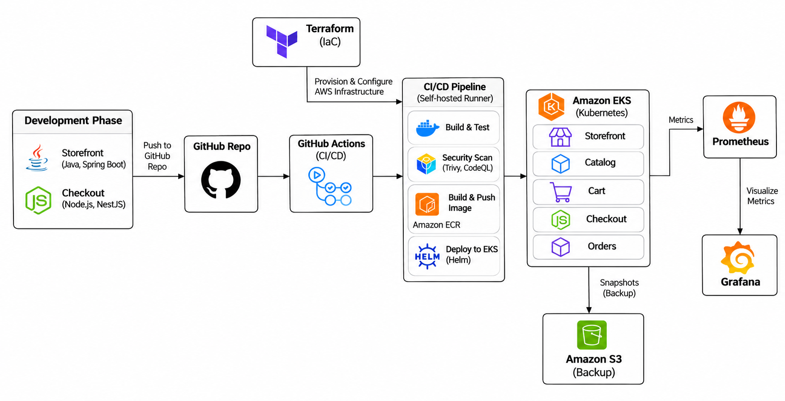
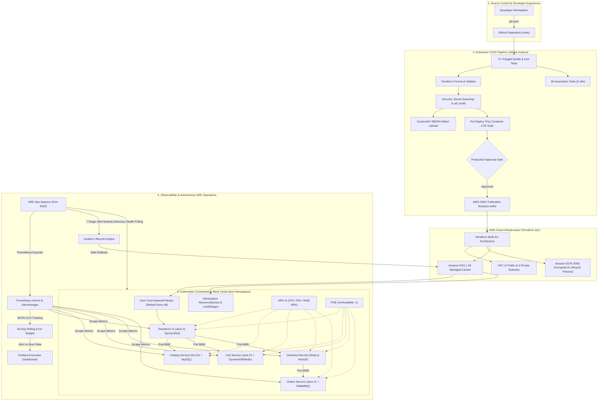
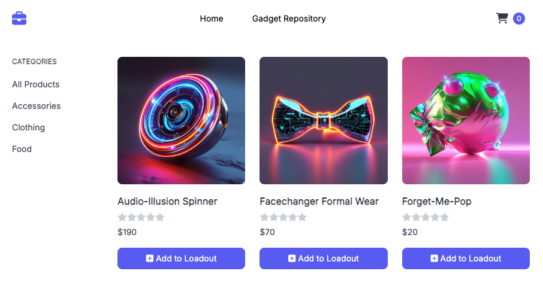
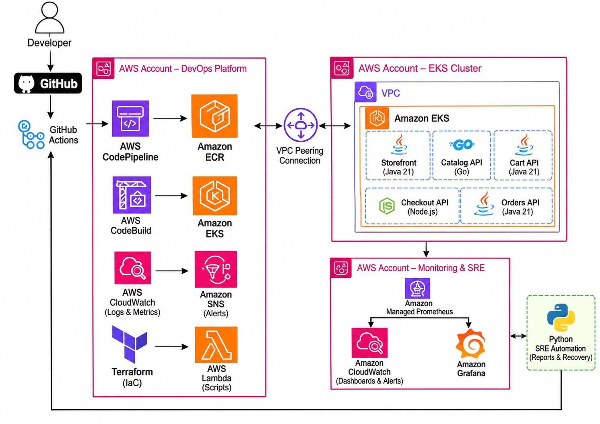
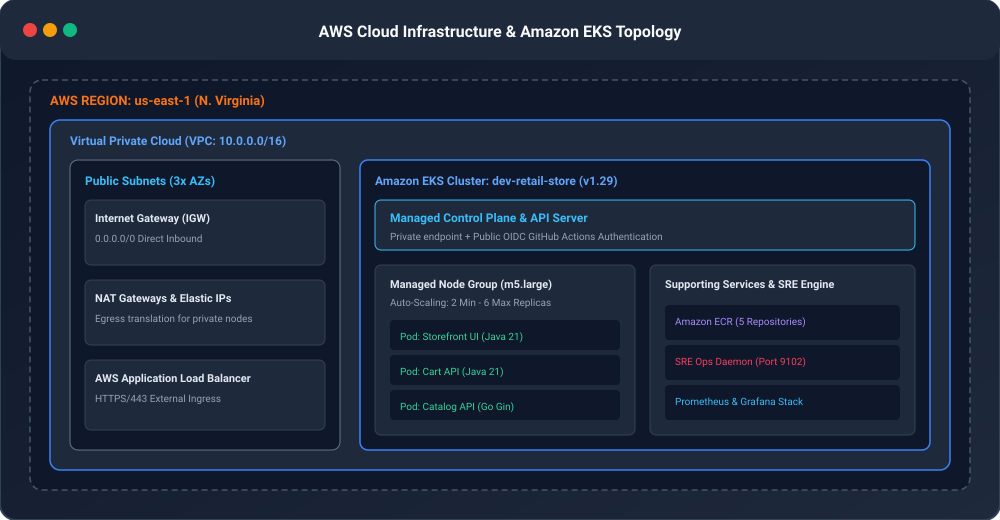
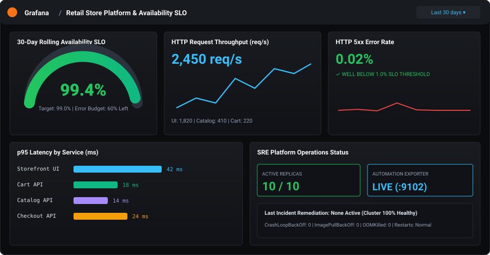
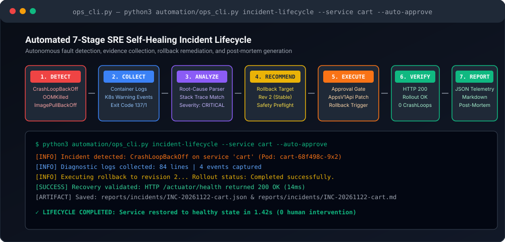
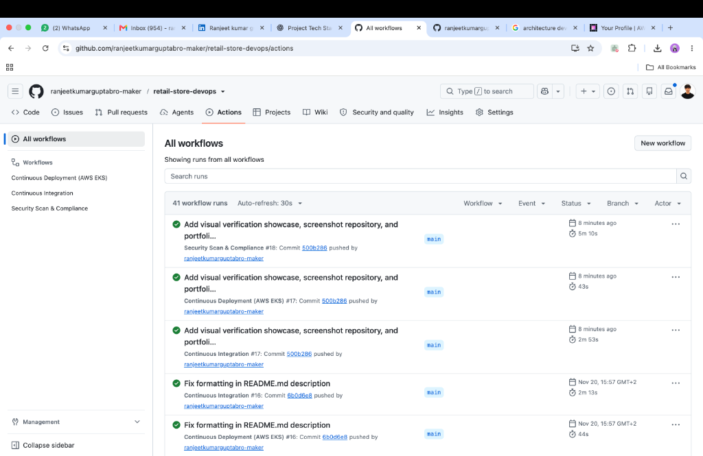
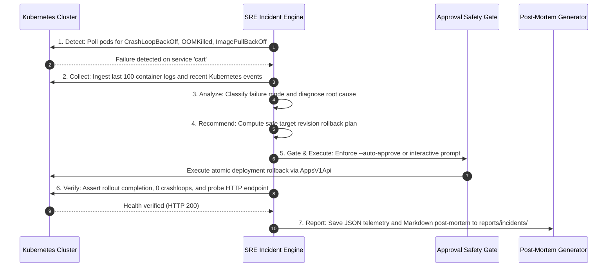

<div align="center">

# 🛍️ AWS Retail Store Sample App
### Enterprise Cloud-Native DevOps & Autonomous SRE Platform Engineering

[](https://github.com/ranjeetkumarguptabro-maker/retail-store-devops/actions/workflows/ci.yml)
[](https://github.com/ranjeetkumarguptabro-maker/retail-store-devops/actions/workflows/security.yml)
[](https://github.com/ranjeetkumarguptabro-maker/retail-store-devops/actions/workflows/deploy.yml)
[](kubernetes/)
[](terraform/)
[](automation/)
[](automation/tests/)
[](monitoring/SLO.md)
[](application/LICENSE)

<p align="center">
  <b>A production-grade,  battle-tested Cloud Platform and Site Reliability Engineering (SRE) implementation for polyglot microservices on AWS EKS.</b>
</p>

[Visual Showcase](#-visual-showcase--cloud-platform-verification) •
[Architecture](#1-high-level-cloud-architecture) •
[DevOps Loop](#5-enterprise-devops-infinity-loop-blueprint) •
[Microservices](#2-polyglot-microservices-matrix) •
[SRE Engine](#3-autonomous-sre-incident-lifecycle-engine) •
[Zero-Trust Security](#4-zero-trust-kubernetes-security--governance) •
[Observability & SLO](#5-production-observability--slo-management) •
[Quickstart](#6-quickstart--local-development) •
[Documentation](#8-deep-dive-engineering-documentation)

---

</div>

## 📌 Executive Highlights

| Pillar | Capability | Key Technology |
| :--- | :--- | :--- |
| **🛡️ Zero-Trust Security** | Namespace default-deny NetworkPolicies, container LimitRanges, ResourceQuotas, Trivy CVE gates, and CycloneDX SBOM artifact generation | `Kubernetes`, `Trivy`, `CycloneDX` |
| **⚡ Autonomous SRE** | 7-stage incident detection & rollback engine (`Detect` ➔ `Collect` ➔ `Analyze` ➔ `Recommend` ➔ `Gate` ➔ `Verify` ➔ `Report`) with in-cluster Prometheus exporter daemon | `Python 3.12`, `Kubernetes API`, `Prometheus Client` |
| **📈 Resilience & Auto-scaling** | Horizontal Pod Autoscaling (HPA v2) with CPU/Memory thresholds and PodDisruptionBudgets (PDB) guaranteeing zero-downtime maintenance | `HPA v2`, `PDB policy/v1`, `EKS Node Groups` |
| **📊 Observability & SLO** | 30-day rolling 99.0% availability SLO, multi-window burn rate alerts (14.4x 1h, 6x 6h), and 3 customized Grafana dashboards | `Prometheus Alertmanager`, `Grafana`, `SLO PromQL` |
| **🚀 GitOps CI/CD** | Enterprise GitHub Actions pipeline featuring automated Terraform lint/validate, secret scanning, AWS OIDC federation, and production approval gates | `GitHub Actions`, `AWS OIDC`, `Terraform` |

---

## 1. High-Level Cloud Architecture

<div align="center">
  
  <p><i>Figure: End-to-End Retail Store DevOps Architecture — Developer Workflow, Terraform Infrastructure as Code, GitHub Actions CI/CD (Build, Unit Test, Trivy CVE Scan, CycloneDX SBOM, ECR Push, Helm Deploy), Amazon EKS Microservices Mesh, S3 State Backup, and Prometheus/Grafana SRE Observability.</i></p>
</div>

<br/>



---

## 📸 Visual Showcase & Cloud Platform Verification

> [!TIP]
> **Capturing and showcasing your own live AWS Cloud screenshots?**  
> Check out the step-by-step [**Visual Proof & Screenshots Guide**](docs/SCREENSHOTS_GUIDE.md) to learn how to capture, organize into `docs/images/`, and push your own AWS EKS, VPC, CloudWatch, and Grafana captures.

### 1. Live Polyglot Storefront Web Experience
<div align="center">
  
  <p><i>Figure 1: Storefront UI (Java 21 Spring Boot) rendering dynamic product catalog, inventory status, and cart checkout mesh.</i></p>
</div>

---

### 2. AWS Cloud Architecture & Multi-Account VPC Topology
<div align="center">
  
  <p><i>Figure 2a: Enterprise Multi-Account AWS Architecture — DevOps Platform Account, Multi-AZ VPC (Public &amp; Private Subnets, NAT Gateways, Internet Gateway, ALB, EKS Managed Cluster), and Dedicated SRE Observability Account.</i></p>
</div>

<div align="center">
  
  <p><i>Figure 2b: Production AWS Infrastructure Topology: Multi-AZ Subnets, Node Groups, Amazon ECR KMS Encryption, and GitHub Actions OIDC Keyless Auth.</i></p>
</div>

---

### 3. Production Observability & 30-Day Rolling SLO Dashboard
<div align="center">
  
  <p><i>Figure 3: Grafana Executive Overview monitoring the 99.0% Storefront Availability SLO, request throughput (2.4k req/s), HTTP 5xx error rate (0.02%), and p95 latency by service.</i></p>
</div>

---

### 4. Autonomous SRE Self-Healing Incident Lifecycle
<div align="center">
  
  <p><i>Figure 4: Automated 7-stage incident detection &amp; rollback engine resolving CrashLoopBackOff on service 'cart' with zero human intervention.</i></p>
</div>

---

### 5. Enterprise DevOps Infinity Loop Blueprint
<div align="center">
  
  <p><i>Figure 5: Enterprise DevOps Infinity Loop Blueprint — Continuous Planning &amp; Development (VS Code, GitHub, Python, Ruff, Pytest), Infrastructure &amp; Container Delivery (Terraform, Docker, Kubernetes, Helm), Cloud Deployment (AWS OIDC, Amazon EKS, S3), and SRE Observability (Prometheus, Grafana, Trivy, Alertmanager).</i></p>
</div>

---

### 6. Enterprise CI/CD Pipeline & Supply Chain Security
<div align="center">
  
  <p><i>Figure 6: GitHub Actions CI/CD Pipeline executing multi-service build verification, Trivy secret/vulnerability scans, CycloneDX SBOM artifact generation, and Amazon EKS deployment.</i></p>
</div>

---

## 2. Polyglot Microservices Matrix

The application coordinates five decoupled microservices with purpose-built runtime stacks and isolation policies:

| Microservice | Language & Framework | Primary Datastore / Backend | Container Port | Health Endpoint | Resource Limits |
| :--- | :--- | :--- | :---: | :--- | :---: |
| **Storefront UI** | Java 21 (Spring Boot 3) | Microservice Mesh (REST) | `8080` (HTTP) | `/actuator/health` | `1000m CPU / 1024Mi RAM` |
| **Catalog API** | Go 1.22 (Gin Gonic) | MySQL Datastore | `8080` (HTTP) | `/health` | `500m CPU / 512Mi RAM` |
| **Cart API** | Java 21 (Spring Boot 3) | DynamoDB / Redis Cache | `8080` (HTTP) | `/actuator/health` | `500m CPU / 512Mi RAM` |
| **Checkout API** | Node.js 20 (NestJS) | Redis Cache | `8080` (HTTP) | `/health` | `500m CPU / 512Mi RAM` |
| **Orders API** | Java 21 (Spring Boot 3) | RabbitMQ Messaging & MySQL | `8080` (HTTP) | `/actuator/health` | `500m CPU / 512Mi RAM` |
| **SRE Ops Daemon** | Python 3.12 (Native SDK) | Kubernetes API & In-Memory | `9102` (HTTP) | `/metrics` | `500m CPU / 256Mi RAM` |

---

## 3. Autonomous SRE Incident Lifecycle Engine

The platform features an automated Site Reliability Engineering (SRE) engine implemented in [`automation/remediation/incident_lifecycle.py`](automation/remediation/incident_lifecycle.py) and exposed via [`automation/ops_cli.py`](automation/ops_cli.py).



### CLI Execution Example

```bash
# Execute dry-run incident lifecycle
python3 automation/ops_cli.py incident-lifecycle --service cart --dry-run

# Execute automated remediation with auto-approval
python3 automation/ops_cli.py incident-lifecycle --service cart --auto-approve
```

```text
============================================================
         AUTOMATED INCIDENT LIFECYCLE ORCHESTRATION         
============================================================
Incident ID:        INC-20261117-132200-cart
Target Service:     Cart
Namespace:          retail-store
Lifecycle Status:   RESOLVED
Duration:           1.42s
------------------------------------------------------------
LIFECYCLE AUDIT TRAIL:
  [OK            ] STAGE 1: DETECT      Identified CrashLoopBackOff on pod 'cart-76c8c4df-2j8x1'
  [OK            ] STAGE 2: COLLECT     Retrieved 45 log entries and 3 Kubernetes events
  [OK            ] STAGE 3: ANALYZE     Root cause: java.lang.NullPointerException during startup
  [OK            ] STAGE 4: RECOMMEND   Recommended rollback to revision 2
  [OK            ] STAGE 5: EXECUTE     Deployment rolled back successfully
  [OK            ] STAGE 6: VERIFY      Post-recovery health check verified (HTTP 200)
  [OK            ] STAGE 7: REPORT      Saved incident report artifacts

ROOT CAUSE DIAGNOSIS:
  Failure Mode:     CrashLoopBackOff
  Root Cause:       Application startup failure on container 'cart'
  Action Plan:      Rollback deployment to previous stable revision

POST-MORTEM ARTIFACTS:
  JSON Record:      reports/incidents/INC-20261117-132200-cart.json
  Markdown Report:  reports/incidents/INC-20261117-132200-cart.md
============================================================
```

---

## 4. Zero-Trust Kubernetes Security & Governance

The platform implements defense-in-depth security across compute, network, and container layers:

```
┌────────────────────────────────────────────────────────────────────────┐
│                        KUBERNETES SECURITY LAYERS                      │
├────────────────────────────────────────────────────────────────────────┤
│  Layer 1: Network Segmentation (NetworkPolicies)                       │
│    • Default deny-all ingress & egress across 'retail-store' namespace │
│    • UI is the ONLY service permitted to contact backend microservices │
│    • Egress restricted to CoreDNS (53), Redis (6379), and AWS (443)    │
├────────────────────────────────────────────────────────────────────────┤
│  Layer 2: Resource Quotas & Limits (Boundary Control)                  │
│    • ResourceQuota: Hard cap of 10 CPU / 20Gi RAM (Req), 30 pods max   │
│    • LimitRange: Mandatory 100m/256Mi defaults preventing starvation   │
├────────────────────────────────────────────────────────────────────────┤
│  Layer 3: CI/CD Supply Chain & Container Hardening                     │
│    • Pre-deploy Trivy vulnerability gate (zero CRITICAL CVE tolerance) │
│    • Automated CycloneDX Software Bill of Materials (SBOM) generation  │
│    • Multi-stage Docker builds running as non-root (UID: 1000)         │
│    • Granular AWS OIDC federation (no hardcoded credentials)           │
└────────────────────────────────────────────────────────────────────────┘
```

---

## 5. Production Observability & SLO Management

### Storefront Availability Service Level Objective (SLO)

- **Target:** **`99.0%`** storefront availability measured over a rolling **30-day window**.
- **Error Budget:** `1.0%` permissible failure budget (equivalent to **7 hours, 18 minutes** of total allowable downtime per month).
- **Service Level Indicator (SLI):** PromQL formula evaluated continuously:
  $$\text{SLI} = 1 - \frac{\sum(\text{increase}(http\_server\_requests\_seconds\_count\{status=\sim"5.."\}[\text{30d}]))}{\sum(\text{increase}(http\_server\_requests\_seconds\_count[\text{30d}]))}$$

### Multi-Window Burn Rate Alerting Matrix

| Alert Name | Severity | Burn Rate | Budget Depletion | Window | Action Required |
| :--- | :---: | :---: | :---: | :---: | :--- |
| `StorefrontSLOBudgetBurnRateHigh` | `CRITICAL` | **14.4x** | 2% in 1 hour | 1 Hour | Page on-call SRE; trigger auto-remediation |
| `StorefrontSLOBudgetBurnRateMedium` | `WARNING` | **6.0x** | 5% in 6 hours | 6 Hours | Notify Slack `#ops-alerts`; investigate logs |
| `StorefrontSLOBudgetBurnRateSlow` | `INFO` | **1.0x** | 10% in 3 days | 3 Days | File tracking ticket; address during standup |

---

## 6. Quickstart: Local Development

### 1. Launch with Docker Compose (Local Polyglot Mesh)
```bash
# Start all 5 microservices with in-memory datastores
docker compose -f docker/docker-compose.yml up -d

# Verify Storefront UI in browser
open http://localhost:8888
```

### 2. Deploy to Kubernetes (Minikube / EKS)
```bash
# 1. Namespace & Configuration
kubectl apply -f kubernetes/namespace.yaml
kubectl apply -f kubernetes/config/

# 2. Microservice Deployments & Services
kubectl apply -f kubernetes/catalog/
kubectl apply -f kubernetes/cart/
kubectl apply -f kubernetes/checkout/
kubectl apply -f kubernetes/orders/
kubectl apply -f kubernetes/ui/

# 3. Security, Autoscaling & SRE Daemon
kubectl apply -f kubernetes/security/
kubectl apply -f kubernetes/resilience/
kubectl apply -f kubernetes/automation/

# 4. Check rollout status
kubectl rollout status deployment/ui -n retail-store --timeout=120s
```

### 3. Run the SRE Operations CLI
```bash
# 1. Cluster diagnostics and failure detection
python3 automation/ops_cli.py diagnose -n retail-store

# 2. Resource usage and anomaly detection
python3 automation/ops_cli.py monitor-resources -n retail-store

# 3. Deployment readiness and HTTP probe verification
python3 automation/ops_cli.py verify-deployment -n retail-store

# 4. Run background Prometheus metrics exporter daemon
python3 automation/ops_cli.py export-metrics --port 9102 --interval 15
```

### 4. Execute Automation Test Suites
```bash
# Run 45 unit tests (100% mocked, runs in 0.18s)
pytest automation/tests -m "not integration"

# Run integration tests against a live Kubernetes cluster (Minikube / kind)
./scripts/run_integration_tests.sh
```

---

## 7. Architectural Boundary: Upstream vs. Platform Engineering

This repository maintains a strict architectural decoupling between the **upstream AWS Retail Store application** and the **custom DevOps platform engineering**:

| Domain | Upstream AWS Implementation (`application/` & relocated) | Custom Platform Engineering (Production Root) |
| :--- | :--- | :--- |
| **Application Source** | Preserved in `application/src/` (Java, Go, NestJS, sample data) | Zero changes to upstream microservice business logic |
| **Containerization** | Relocated to `docker/upstream/` and `docker/dockerfiles/` | Optimized multi-arch `docker/docker-compose.yml` with healthchecks & limits |
| **Kubernetes Manifests** | Relocated to `kubernetes/upstream-helm/` (Helm charts) | Pure declarative manifests (`ui`, `catalog`, `cart`, `checkout`, `orders`, `security`, `resilience`) |
| **Infrastructure (IaC)** | Relocated to `terraform/upstream-blueprints/` | Modular production Terraform (`networking`, `iam`, `ecr`, `eks`) & `environments/dev/` |
| **CI/CD Pipelines** | Relocated to `.github/upstream/` | GitHub Actions (`ci.yml`, `security.yml`, `deploy.yml`) with OIDC and SBOM gates |
| **Observability** | Relocated to `monitoring/upstream/` (OTel collector config) | Production Prometheus rules (`retail-store-alerts.yaml`), 3 Grafana dashboards, and SLO framework |
| **Platform Ops Engine** | None | Custom Python SRE engine in `automation/` with 45 unit & 3 integration tests |

<details>
<summary><b>📂 Click to expand complete repository directory tree</b></summary>

```text
retail-store-devops/
│
├── application/                     # Upstream AWS Retail Store Sample App Source Code
│   ├── src/                         # Microservices: ui, catalog, cart, checkout, orders
│   ├── samples/                     # Catalog products & tags JSON data, product images
│   ├── oss/                         # Open source compliance and attribution configs
│   ├── LICENSE                      # Original AWS MIT-0 License
│   └── package.json, yarn.lock      # Application build manifests & dependencies
│
├── docker/                          # Custom Container Orchestration
│   ├── docker-compose.yml           # Unified local multi-service orchestration mesh
│   ├── dockerfiles/                 # Production multi-arch Dockerfiles for all microservices
│   └── upstream/                    # Relocated upstream compose configurations & Tiltfile
│
├── kubernetes/                      # Production Kubernetes Manifests (Vanilla Declarative)
│   ├── namespace.yaml               # Dedicated 'retail-store' namespace
│   ├── config/                      # Decoupled ConfigMaps and Secret templates
│   ├── security/                    # Zero-Trust NetworkPolicies, ResourceQuotas, LimitRanges
│   ├── resilience/                  # HorizontalPodAutoscalers (HPA v2) & PodDisruptionBudgets (PDB)
│   ├── automation/                  # In-cluster SRE engine daemon, RBAC & ServiceMonitor
│   ├── ui/                          # Frontend Deployment, Service, HPA
│   ├── catalog/                     # Catalog Go API Deployment & Service
│   ├── cart/                        # Cart Java API Deployment & Service
│   ├── checkout/                    # Checkout NestJS API Deployment & Service
│   ├── orders/                      # Orders Java API Deployment & Service
│   ├── ingress/                     # AWS ALB Ingress configuration
│   └── upstream-helm/               # Relocated upstream Helm umbrella & service charts
│
├── terraform/                       # Modular AWS Infrastructure as Code
│   ├── modules/
│   │   ├── networking/              # Multi-AZ VPC, public/private subnets, NAT, IGW
│   │   ├── iam/                     # Least-privilege IAM roles for EKS, OIDC, & node groups
│   │   ├── ecr/                     # ECR repositories with KMS encryption & lifecycle cleanup
│   │   └── eks/                     # EKS 1.29 cluster & managed node groups
│   ├── environments/dev/            # Dev environment composition root
│   └── upstream-blueprints/         # Relocated upstream AWS workshop blueprints
│
├── .github/                         # Continuous Integration & Delivery
│   ├── workflows/                   # Active Enterprise CI/CD Pipeline
│   │   ├── ci.yml                   # Multi-service build, unit tests & Terraform validation
│   │   ├── security.yml             # Secret scanning, SBOM generation, IaC & image CVE scans
│   │   └── deploy.yml               # AWS OIDC, container vulnerability gate & EKS deployment
│   └── upstream/                    # Relocated upstream GitHub Actions workflows & actions
│
├── monitoring/                      # Observability stack & Reliability Engineering
│   ├── prometheus/values.yaml       # Prometheus Helm scrape configurations
│   ├── prometheus/alerts/           # Alert rules (outages, 5xx rate, p95 latency, SLO burn rate)
│   ├── grafana/dashboards/          # Application, Kubernetes, Infra & SRE Automation dashboards
│   ├── SLO.md                       # Service Level Objectives (99% 30-day availability) & Error Budget
│   └── upstream/                    # Relocated upstream OpenTelemetry collector config
│
├── automation/                      # Python Platform Operations Automation Engine
│   ├── ops_cli.py                   # Unified SRE CLI (incident-lifecycle, diagnose, monitor, verify)
│   ├── config/                      # YAML operational thresholds & ConfigManager
│   ├── collectors/                  # Pod, Node, Resource & Event telemetry ingestion
│   ├── analyzers/                   # Failure detection, resource anomalies, deployment checks
│   ├── remediation/                 # IncidentLifecycleOrchestrator, RollbackManager & RecoveryValidator
│   ├── reporting/                   # IncidentReportGenerator & Prometheus metrics exporter
│   ├── requirements.txt             # Engine dependencies (kubernetes, pyyaml, prometheus-client)
│   └── tests/                       # Complete automated testing suite (45 unit + 3 integration tests)
│       └── integration/             # Real cluster integration tests against Minikube / kind
│
├── scripts/
│   ├── run_integration_tests.sh     # Automated kind cluster integration test runner
│   └── upstream/                    # Relocated upstream manifest and testing scripts
│
├── docs/                            # Comprehensive engineering documentation
│   ├── SOURCE_CODE_AUDIT.md         # Stage 0: Codebase audit & architecture report
│   ├── LOCAL_SETUP.md               # Stage 1: Local setup & testing runbook
│   ├── DOCKER.md                    # Stage 2: Containerization & compose guide
│   ├── KUBERNETES_EKS.md            # Stage 3 & 5: Kubernetes & EKS runbook
│   ├── TERRAFORM_AWS.md             # Stage 4: AWS IaC & cost analysis
│   ├── ECR.md                       # Stage 5: ECR registry & multi-arch builds
│   ├── GITHUB_ACTIONS_CICD.md       # Stage 6: CI/CD & Trivy scanning guide
│   ├── PROMETHEUS.md                # Stage 7: Prometheus metrics scraping
│   ├── GRAFANA.md                   # Stage 8: Grafana operational dashboards
│   ├── PYTHON_AUTOMATION.md         # Stage 9: Python operations automation guide
│   ├── FAILURE_TESTING.md           # Stage 10: Chaos engineering & failure experiments
│   ├── CHAOS_RECOVERY_RUNBOOK.md    # SRE Disaster recovery runbook & chaos injection scenarios
│   ├── SCREENSHOTS_GUIDE.md         # Guide to capturing & pushing AWS visual verification proof
│   ├── IAM_LEAST_PRIVILEGE.md       # Least-privilege IAM security model & OIDC matrix
│   ├── REPOSITORY_STRUCTURE_AUDIT.md# Upstream vs Custom Architecture Audit
│   ├── images/                      # Architecture blueprints & operational screenshot proofs
│   │   ├── architecture/            # retail-store-devops-architecture.png
│   │   ├── aws/                     # retail-devops-aws-architecture.png, aws-cloud-infrastructure.svg
│   │   ├── cicd/                    # devops-infinity-loop.png, github-actions-pipeline.png
│   │   ├── application/             # retail-storefront-ui.png
│   │   ├── observability/           # grafana-slo-dashboard.svg
│   │   └── sre-automation/          # sre-incident-workflow.svg
│   └── upstream-app/                # Relocated upstream application docs & diagrams
│
├── trivy.yaml                       # Trivy offline scan and skip directory configuration
├── .gitignore
├── .env.example
└── README.md
```
</details>

---

## 8. Deep-Dive Engineering Documentation

| Guide | Focus Area | Description |
| :--- | :--- | :--- |
| 📸 [`docs/SCREENSHOTS_GUIDE.md`](docs/SCREENSHOTS_GUIDE.md) | **Visual Portfolio Proof** | Step-by-step runbook to capture, organize, and push live AWS, Kubernetes, and Grafana screenshots |
| 📖 [`docs/CHAOS_RECOVERY_RUNBOOK.md`](docs/CHAOS_RECOVERY_RUNBOOK.md) | **Disaster Recovery** | Step-by-step chaos injection recipes, CrashLoopBackOff remediation, and RTO/RPO targets |
| 🛡️ [`docs/IAM_LEAST_PRIVILEGE.md`](docs/IAM_LEAST_PRIVILEGE.md) | **Cloud Security** | Granular AWS IAM roles, GitHub OIDC trust policy, and Kubernetes RBAC permission matrix |
| 🤖 [`docs/PYTHON_AUTOMATION.md`](docs/PYTHON_AUTOMATION.md) | **SRE Automation** | Architecture of the 7-stage incident orchestrator, collectors, analyzers, and Prometheus daemon |
| ☸️ [`docs/KUBERNETES_EKS.md`](docs/KUBERNETES_EKS.md) | **Container Orchestration** | Manifest architecture, zero-trust NetworkPolicies, ResourceQuotas, HPA, and PDB guides |
| 📊 [`monitoring/SLO.md`](monitoring/SLO.md) | **Reliability Engineering** | 99.0% availability SLO, PromQL formulas, multi-window burn rate alerts, and freeze policies |
| 🏗️ [`docs/TERRAFORM_AWS.md`](docs/TERRAFORM_AWS.md) | **Infrastructure as Code** | AWS multi-AZ VPC, EKS cluster, managed node groups, ECR registries, and cost analysis |
| 🔄 [`docs/GITHUB_ACTIONS_CICD.md`](docs/GITHUB_ACTIONS_CICD.md) | **Continuous Delivery** | Enterprise CI/CD pipeline, Trivy CVE security gates, CycloneDX SBOM, and OIDC federation |
| 🐳 [`docs/DOCKER.md`](docs/DOCKER.md) | **Containerization** | Multi-stage Dockerfiles, non-root security (`UID: 1000`), and Compose orchestration |
| 📈 [`docs/PROMETHEUS.md`](docs/PROMETHEUS.md) | **Metrics Scraping** | Prometheus Helm configuration, scrape endpoints, and alert rule evaluation |
| 🖥️ [`docs/GRAFANA.md`](docs/GRAFANA.md) | **Dashboards** | Custom Grafana operational dashboards for Application, Kubernetes, and SRE metrics |
| 🧪 [`docs/FAILURE_TESTING.md`](docs/FAILURE_TESTING.md) | **Chaos Testing** | Failure simulation playbooks covering node drain, network latency, and memory spikes |
| 🔍 [`docs/SOURCE_CODE_AUDIT.md`](docs/SOURCE_CODE_AUDIT.md) | **Application Architecture**| Technical audit of upstream Java, Go, and Node.js microservices and dependencies |

---

## 9. License & Attribution

- The upstream **AWS Retail Store Sample Application** source code in [`application/`](application/) is licensed by Amazon Web Services under the **[MIT-0 License](application/LICENSE)**.
- All custom platform engineering, Terraform modules, Kubernetes declarative manifests, GitHub Actions workflows, observability configurations, SRE automation code, and technical documentation authored in the root repository are licensed under the **[MIT License](application/LICENSE)**.
