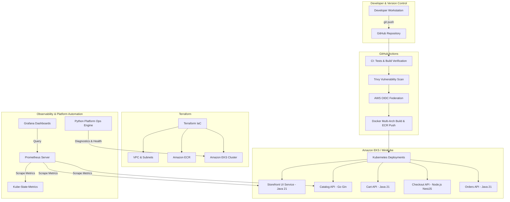

# AWS Retail Store Sample App — End-to-End DevOps & Platform Engineering

[](https://github.com/ranjeetkumarguptabro-maker/retail-store-devops/actions/workflows/ci.yml)
[](https://github.com/ranjeetkumarguptabro-maker/retail-store-devops/actions/workflows/security.yml)
[](LICENSE)

A production-inspired, end-to-end DevOps and Cloud Platform deployment pipeline for the **AWS Retail Store Sample Application** (`aws-containers/retail-store-sample-app`), built around Git, Docker, Kubernetes (Minikube & Amazon EKS), Terraform IaC, GitHub Actions CI/CD with AWS OIDC, Trivy security scanning,  Prometheus, Grafana, and custom Python operational automation.

---

## 1. High-Level Architecture



---

## 2. Technology Stack

| Technology | Purpose | Implementation Details |
|---|---|---|
| **AWS Retail Store App** | Target Application | Polyglot microservices: Java (Spring Boot), Go (Gin), Node.js (NestJS) |
| **Git & GitHub** | Source Control | Semantic commits, branch protection, code review workflows |
| **Docker** | Containerization | Multi-stage, non-root (`appuser: 1000`), multi-arch (ARM64 & AMD64) |
| **Kubernetes** | Orchestration | Rolling updates, readiness/liveness probes, HPA, resource requests/limits |
| **Amazon EKS** | Managed K8s | Managed node groups, VPC CNI, cluster security groups |
| **Terraform** | Infrastructure as Code | Modular design (`networking`, `iam`, `ecr`, `eks`), least-privilege IAM |
| **GitHub Actions** | CI/CD Automation | Workflows for testing, Trivy CVE scanning, AWS OIDC deployment |
| **Trivy** | Container Security | Automated image & filesystem scanning for `CRITICAL` and `HIGH` CVEs |
| **Prometheus** | Metrics Collection | Scrapes Spring Boot Actuator (`/actuator/prometheus`) and Gin (`/metrics`) |
| **Grafana** | Dashboards | Application Overview, Kubernetes Overview, Infrastructure Overview |
| **Python** | Platform Automation | Diagnostic engine detecting CrashLoopBackOff, node readiness, rollout health |
| **Pytest / Unittest** | Automation Testing | Unit test suite with mocks validating failure detection logic |

---

## 3. Architecture Boundary: Upstream Application vs. Platform Engineering

This repository maintains a strict architectural separation between **third-party upstream application code** and **custom DevOps platform engineering**:

| Domain | Upstream AWS Implementation (`application/` & relocated) | Custom Platform Engineering (Root Production) |
|---|---|---|
| **Application Source** | Preserved in `application/src/` (Java, Go, NestJS, tests, sample data) | Zero changes to core business logic; polyglot microservice integrity retained |
| **Containerization** | Relocated to `docker/upstream/` and `docker/dockerfiles/` | `docker/docker-compose.yml` with ARM64/M3 support, in-memory mesh, healthchecks & limits |
| **Kubernetes** | Relocated to `kubernetes/upstream-helm/` (Helm charts & Helmfiles) | Pure vanilla declarative manifests in `kubernetes/` (`ui`, `catalog`, `cart`, `checkout`, `orders`) |
| **Infrastructure (IaC)**| Relocated to `terraform/upstream-blueprints/` (AWS workshop samples) | Modular Terraform in `terraform/modules/` (`networking`, `iam`, `ecr`, `eks`) & `environments/dev/` |
| **CI/CD Pipelines** | Relocated to `.github/upstream/` (internal AWS release workflows) | Active GitHub Actions in `.github/workflows/` (`ci.yml`, `security.yml`, `deploy.yml`) |
| **Observability** | Relocated to `monitoring/upstream/` (OTel collector config) | Production Prometheus Helm values & 3 custom operational Grafana dashboards |
| **Platform Ops Engine** | None | Custom Python SRE engine in `automation/` with 100% unit test coverage |

---

## 4. Repository Structure

```text
retail-store-devops/
│
├── application/                     # Upstream AWS Retail Store Sample App Source Code
│   ├── src/                         # Microservices: ui, catalog, cart, checkout, orders
│   ├── samples/                     # Catalog products & tags JSON data, product images
│   ├── oss/                         # Open source compliance and attribution configs
│   ├── LICENSE                      # Original AWS MIT-0 License
│   └── package.json, yarn.lock      # Application build manifests & dependencies
│
├── docker/                          # Custom Container Orchestration
│   ├── docker-compose.yml           # Unified local multi-service orchestration mesh
│   ├── dockerfiles/                 # Production multi-arch Dockerfiles for all microservices
│   └── upstream/                    # Relocated upstream compose configurations & Tiltfile
│
├── kubernetes/                      # Production Kubernetes Manifests (Vanilla Declarative)
│   ├── namespace.yaml               # Dedicated 'retail-store' namespace
│   ├── config/                      # Decoupled ConfigMaps and Secret templates
│   ├── security/                    # Zero-Trust NetworkPolicies, ResourceQuotas, LimitRanges
│   ├── resilience/                  # HorizontalPodAutoscalers (HPA v2) & PodDisruptionBudgets (PDB)
│   ├── automation/                  # In-cluster SRE engine daemon, RBAC & ServiceMonitor
│   ├── ui/                          # Frontend Deployment, Service, HPA
│   ├── catalog/                     # Catalog Go API Deployment & Service
│   ├── cart/                        # Cart Java API Deployment & Service
│   ├── checkout/                    # Checkout NestJS API Deployment & Service
│   ├── orders/                      # Orders Java API Deployment & Service
│   ├── ingress/                     # AWS ALB Ingress configuration
│   └── upstream-helm/               # Relocated upstream Helm umbrella & service charts
│
├── terraform/                       # Modular AWS Infrastructure as Code
│   ├── modules/
│   │   ├── networking/              # VPC, 3 public & 3 private subnets, NAT, IGW
│   │   ├── iam/                     # Cluster & worker node IAM roles, OIDC provider
│   │   ├── ecr/                     # ECR repositories with KMS encryption & lifecycle cleanup
│   │   └── eks/                     # EKS 1.29 cluster & managed node groups
│   ├── environments/dev/            # Dev environment composition root
│   └── upstream-blueprints/         # Relocated upstream AWS workshop blueprints
│
├── .github/                         # Continuous Integration & Delivery
│   ├── workflows/                   # Active Enterprise CI/CD Pipeline
│   │   ├── ci.yml                   # Multi-service build, unit tests & Terraform validation
│   │   ├── security.yml             # Secret scanning, SBOM generation, IaC & image CVE scans
│   │   └── deploy.yml               # AWS OIDC, container vulnerability gate & EKS deployment
│   └── upstream/                    # Relocated upstream GitHub Actions workflows & actions
│
├── monitoring/                      # Observability stack & Reliability Engineering
│   ├── prometheus/values.yaml       # Prometheus Helm scrape configurations
│   ├── prometheus/alerts/           # Alert rules (outages, 5xx rate, p95 latency, SLO burn rate)
│   ├── grafana/dashboards/          # Application, Kubernetes, Infra & SRE Automation dashboards
│   ├── SLO.md                       # Service Level Objectives (99% 30-day availability) & Error Budget
│   └── upstream/                    # Relocated upstream OpenTelemetry collector config
│
├── automation/                      # Python Platform Operations Automation Engine
│   ├── ops_cli.py                   # Unified SRE CLI (incident-lifecycle, diagnose, monitor, verify)
│   ├── config/                      # YAML operational thresholds & ConfigManager
│   ├── collectors/                  # Pod, Node, Resource & Event telemetry ingestion
│   ├── analyzers/                   # Failure detection, resource anomalies, deployment checks
│   ├── remediation/                 # IncidentLifecycleOrchestrator, RollbackManager & RecoveryValidator
│   ├── reporting/                   # IncidentReportGenerator & Prometheus metrics exporter
│   ├── requirements.txt             # Engine dependencies (kubernetes, pyyaml, prometheus-client)
│   └── tests/                       # Complete automated testing suite (45 unit + 3 integration tests)
│       └── integration/             # Real cluster integration tests against Minikube / kind
│
├── scripts/
│   ├── run_integration_tests.sh     # Automated kind cluster integration test runner
│   └── upstream/                    # Relocated upstream manifest and testing scripts
│
├── docs/                            # Comprehensive engineering documentation
│   ├── SOURCE_CODE_AUDIT.md         # Stage 0: Codebase audit & architecture report
│   ├── LOCAL_SETUP.md               # Stage 1: Local setup & testing runbook
│   ├── DOCKER.md                    # Stage 2: Containerization & compose guide
│   ├── KUBERNETES_EKS.md            # Stage 3 & 5: Kubernetes & EKS runbook
│   ├── TERRAFORM_AWS.md             # Stage 4: AWS IaC & cost analysis
│   ├── ECR.md                       # Stage 5: ECR registry & multi-arch builds
│   ├── GITHUB_ACTIONS_CICD.md       # Stage 6: CI/CD & Trivy scanning guide
│   ├── PROMETHEUS.md                # Stage 7: Prometheus metrics scraping
│   ├── GRAFANA.md                   # Stage 8: Grafana operational dashboards
│   ├── PYTHON_AUTOMATION.md         # Stage 9: Python operations automation guide
│   ├── FAILURE_TESTING.md           # Stage 10: Chaos engineering & failure experiments
│   ├── CHAOS_RECOVERY_RUNBOOK.md    # SRE Disaster recovery runbook & chaos injection scenarios
│   ├── IAM_LEAST_PRIVILEGE.md       # Least-privilege IAM security model & OIDC matrix
│   ├── REPOSITORY_STRUCTURE_AUDIT.md# Upstream vs Custom Architecture Audit
│   ├── RESTRUCTURE_REPORT.md        # Data and Application Separation Migration Report
│   └── upstream-app/                # Relocated upstream application docs & diagrams
│
├── .gitignore
├── .env.example
└── README.md
```

---

## 5. Quickstart: Local Development

### 1. Run the Local Microservices Stack:
```bash
docker compose -f docker/docker-compose.yml up -d
```
Open **[http://localhost:8888](http://localhost:8888)** to interact with the Storefront UI.

### 2. Verify Health and Metrics:
```bash
# Health Check
curl -s http://localhost:8888/actuator/health

# Prometheus Metrics
curl -s http://localhost:8888/actuator/prometheus
```

### 3. Deploy to Kubernetes (Minikube / EKS):
```bash
# Core Services & Namespace
kubectl apply -f kubernetes/namespace.yaml
kubectl apply -f kubernetes/config/
kubectl apply -f kubernetes/catalog/
kubectl apply -f kubernetes/cart/
kubectl apply -f kubernetes/checkout/
kubectl apply -f kubernetes/orders/
kubectl apply -f kubernetes/ui/

# Zero-Trust Security & Autoscaling Policies
kubectl apply -f kubernetes/security/
kubectl apply -f kubernetes/resilience/

# In-Cluster SRE Automation Daemon
kubectl apply -f kubernetes/automation/
```

### 4. Run the Python SRE Operations Engine:
```bash
# Automated incident lifecycle remediation (Detect -> Analyze -> Rollback -> Verify -> Report)
python3 automation/ops_cli.py incident-lifecycle --service cart --auto-approve

# Continuous cluster monitoring and Prometheus metrics HTTP exporter daemon
python3 automation/ops_cli.py export-metrics --port 9102 --interval 15
```

### 5. Run Automation Unit & Integration Tests:
```bash
# Run 45 unit tests (100% mocked, runs in 0.19s)
pytest automation/tests -m "not integration"

# Run live Kubernetes cluster integration tests against Minikube / kind
./scripts/run_integration_tests.sh
```

---

## 6. Teardown & Resource Cleanup

To stop and remove local containers:
```bash
docker compose -f docker/docker-compose.yml down -v
```

To destroy provisioned AWS cloud infrastructure:
```bash
cd terraform/environments/dev
terraform destroy -var-file="terraform.tfvars"
```

---

## 7. License & Attribution
The upstream AWS Retail Store Sample Application source code in `application/` is licensed by Amazon Web Services under the **MIT-0 License** (see `application/LICENSE`).
All custom platform engineering, Terraform modules, Kubernetes manifests, GitHub Actions workflows, observability configurations, and Python SRE automation implementations authored in the root repository are maintained under the **MIT License**.

