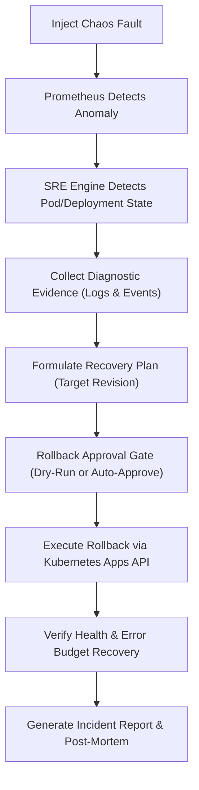

# Chaos Engineering & Disaster Recovery Runbook

This runbook provides reproducible chaos injection scenarios, remediation playbooks, and disaster recovery procedures for the **Retail Store DevOps Platform**.

---

## 1. Resilience Objectives (SLO & RTO/RPO)

| Metric | Target | Measurement Window | Operational Impact |
| :--- | :---: | :---: | :--- |
| **Availability SLO** | `99.0%` | 30-Day Rolling Window | Maximum allowable downtime: 7h 18m |
| **Recovery Time Objective (RTO)** | `< 5 minutes` | Per Incident | Automated rollback completes within 120s |
| **Recovery Point Objective (RPO)** | `0 data loss` | Persistent Data | Cart state persisted in Redis/DynamoDB |

---

## 2. Chaos Injection Scenarios & Automated Recovery



---

### Scenario 1: Simulating Pod `CrashLoopBackOff` (Cart Service)

#### 1. Inject Fault
Force the Cart service to exit immediately with an error exit code upon boot:
```bash
# Update Cart deployment to run a failing exit command
kubectl set env deployment/cart -n retail-store SPRING_PROFILES_ACTIVE=invalid-profile
kubectl rollout status deployment/cart -n retail-store --timeout=60s
```

#### 2. Observe Cluster Degradation
```bash
# Check pod state transitioning to CrashLoopBackOff
kubectl get pods -n retail-store -l app.kubernetes.io/name=cart
```

#### 3. Execute SRE Incident Lifecycle
Run the incident lifecycle engine to detect, collect logs, recommend recovery, and execute rollback:
```bash
python3 automation/ops_cli.py incident-lifecycle --service cart --auto-approve
```

#### 4. Expected Output & Post-Mortem Artifacts
- **Lifecycle Status:** `RESOLVED`
- **Audit Records Generated:**
  - `reports/incidents/INC-<timestamp>-cart.json`
  - `reports/incidents/INC-<timestamp>-cart.md`
- **Application Health:** Cart service restored to previous healthy revision with HTTP 200 health probe.

---

### Scenario 2: Simulating Broken Rollout (`ImagePullBackOff`)

#### 1. Inject Fault
Deploy an unresolvable container image tag to the Catalog service:
```bash
kubectl set image deployment/catalog catalog=public.ecr.aws/aws-containers/retail-store-sample-catalog:v999.0.0-broken -n retail-store
```

#### 2. Run Deployment Verification Gate
```bash
python3 automation/ops_cli.py verify-deployment -n retail-store
```
*Result:* Returns exit code `1`, identifying stuck replica set and missing image.

#### 3. Execute SRE Rollback
```bash
python3 automation/ops_cli.py rollback -d catalog -n retail-store --confirm
```

---

### Scenario 3: Simulating Memory Exhaustion (`OOMKilled`) & HPA Response

#### 1. Stress Container Memory
Run a temporary stress container inside the namespace or reduce memory limit:
```bash
# Temporarily constrain Cart container memory to 64Mi to force OOM
kubectl patch deployment cart -n retail-store --patch '{"spec":{"template":{"spec":{"containers":[{"name":"cart","resources":{"limits":{"memory":"64Mi"}}}]}}}}'
```

#### 2. Validate OOMKilled Anomaly Detection
```bash
python3 automation/ops_cli.py diagnose -s cart -n retail-store
```
*Result:* Detects `OOMKilled` termination with exit code `137` and advises memory limit elevation.

#### 3. Restore HPA and Normal Limit Range
```bash
kubectl apply -f kubernetes/cart/deployment.yaml
kubectl apply -f kubernetes/resilience/horizontal-pod-autoscalers.yaml
```

---

### Scenario 4: Simulating Zero-Trust Network Policy Enforcement

#### 1. Test Ingress Isolation
Attempt to access the Cart service directly from an unauthorized pod or namespace:
```bash
kubectl run unauthorized-probe --image=curlimages/curl --rm -it --restart=Never -n default -- curl -m 3 http://cart.retail-store:8080/actuator/health
```
*Result:* Request times out (`exit code 28`) because `kubernetes/security/network-policies.yaml` blocks cross-namespace access and non-UI callers.

#### 2. Test Authorized UI Communication
```bash
# Exec inside UI pod to query Cart service
UI_POD=$(kubectl get pod -n retail-store -l app.kubernetes.io/name=ui -o jsonpath='{.items[0].metadata.name}')
kubectl exec -n retail-store "$UI_POD" -- wget -qO- http://cart:8080/actuator/health
```
*Result:* Returns HTTP 200 `{"status":"UP"}`.

---

### Scenario 5: SLO Error Budget Burn & Deployment Freeze Policy

When Prometheus alert `StorefrontSLOBudgetBurnRateHigh` fires:

1. **Calculate Remaining Error Budget:**
   ```promql
   1 - (
     sum(increase(http_server_requests_seconds_count{status=~"5.."}[30d]))
     /
     sum(increase(http_server_requests_seconds_count[30d]))
   )
   ```
2. **Execute Deployment Freeze:**
   - If error budget consumption exceeds `20% in 1 hour` (14.4x burn rate) or `50% in 6 hours` (6x burn rate), automatic CI/CD deployment freeze is enacted.
   - Non-emergency production releases are paused until 24 consecutive hours of SLA compliance.
3. **Escalate to On-Call SRE:**
   - Check Grafana dashboard `application-overview.json`.
   - Inspect incident post-mortems in `reports/incidents/`.

---

## 3. Disaster Recovery Runbook Checklist

- [ ] Identify affected microservice via `python3 automation/ops_cli.py diagnose`
- [ ] Inspect container logs and Kubernetes events
- [ ] Execute automated rollback via `python3 automation/ops_cli.py incident-lifecycle`
- [ ] Validate readiness probes via `python3 automation/ops_cli.py verify-deployment`
- [ ] Review Grafana SLO gauge to ensure availability returns above 99.0%
- [ ] Archive post-mortem markdown report in Git repository
