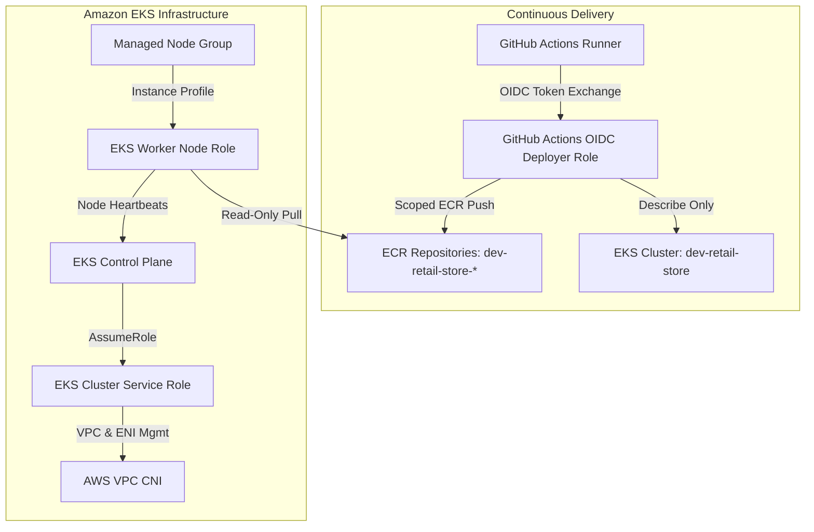

# Least-Privilege IAM Architecture & Access Control Matrix

This document defines the least-privilege Identity and Access Management (IAM) security model implemented across the Retail Store DevOps platform, spanning Amazon EKS cluster roles, worker node profiles, and GitHub Actions AWS OIDC continuous deployment roles.

---

## 1. Security Design Principles

1. **Explicit Resource Scoping**: Wildcard resources (`*`) are prohibited for state mutation actions. IAM policies restrict actions to specific ECR repository and EKS cluster ARNs.
2. **Zero Permanent Credentials**: No static AWS access keys or secret keys are stored in GitHub Secrets or on developer workstations. All CI/CD pipelines authenticate via cryptographically verified OpenID Connect (OIDC) federated role assumption.
3. **Role Separation**: Infrastructure provisioning, container registry push, cluster administration, and runtime application pods each operate under isolated IAM identities.

---

## 2. IAM Role Architecture Overview



---

## 3. Role Specification Matrix

### 1. GitHub Actions CI/CD Deployment Role (`retail-store-github-deployer`)

- **Trust Policy (OIDC Federation)**:
```json
{
  "Version": "2012-10-17",
  "Statement": [
    {
      "Effect": "Allow",
      "Principal": {
        "Federated": "arn:aws:iam::ACCOUNT_ID:oidc-provider/token.actions.githubusercontent.com"
      },
      "Action": "sts:AssumeRoleWithWebIdentity",
      "Condition": {
        "StringEquals": {
          "token.actions.githubusercontent.com:aud": "sts.amazonaws.com"
        },
        "StringLike": {
          "token.actions.githubusercontent.com:sub": "repo:ranjeetkumarguptabro-maker/retail-store-devops:ref:refs/heads/main"
        }
      }
    }
  ]
}
```

- **Permission Policy: Granular ECR Multi-Arch Push**:
```json
{
  "Version": "2012-10-17",
  "Statement": [
    {
      "Sid": "ECRAuthToken",
      "Effect": "Allow",
      "Action": "ecr:GetAuthorizationToken",
      "Resource": "*"
    },
    {
      "Sid": "ScopedECRPushPull",
      "Effect": "Allow",
      "Action": [
        "ecr:BatchCheckLayerAvailability",
        "ecr:GetDownloadUrlForLayer",
        "ecr:BatchGetImage",
        "ecr:PutImage",
        "ecr:InitiateLayerUpload",
        "ecr:UploadLayerPart",
        "ecr:CompleteLayerUpload"
      ],
      "Resource": "arn:aws:ecr:us-east-1:ACCOUNT_ID:repository/dev-retail-store-*"
    }
  ]
}
```

- **Permission Policy: Scoped EKS Deployment**:
```json
{
  "Version": "2012-10-17",
  "Statement": [
    {
      "Sid": "ScopedEKSClusterDescribe",
      "Effect": "Allow",
      "Action": "eks:DescribeCluster",
      "Resource": "arn:aws:eks:us-east-1:ACCOUNT_ID:cluster/dev-retail-store"
    }
  ]
}
```

---

### 2. EKS Control Plane Cluster Role (`dev-retail-store-cluster-role`)

Defined in [`terraform/modules/iam/main.tf`](../terraform/modules/iam/main.tf):
- **Principal**: `eks.amazonaws.com`
- **Managed Attachments**:
  - `arn:aws:iam::aws:policy/AmazonEKSClusterPolicy`: Manages cluster API server and controller nodes.
  - `arn:aws:iam::aws:policy/AmazonEKSVPCResourceController`: Allocates ENIs and private IPs for pod networking.

---

### 3. EKS Managed Worker Node Role (`dev-retail-store-node-role`)

Defined in [`terraform/modules/iam/main.tf`](../terraform/modules/iam/main.tf):
- **Principal**: `ec2.amazonaws.com`
- **Managed Attachments**:
  - `arn:aws:iam::aws:policy/AmazonEKSWorkerNodePolicy`: Node agent daemon communication with control plane.
  - `arn:aws:iam::aws:policy/AmazonEKS_CNI_Policy`: Secondary IP allocation via `aws-node` daemonset.
  - `arn:aws:iam::aws:policy/AmazonEC2ContainerRegistryReadOnly`: Read-only image pulling from ECR repositories. **Write/delete permissions are strictly excluded.**

---

## 4. Kubernetes In-Cluster RBAC Least-Privilege

Within the cluster, platform automation and developer access are bounded by Kubernetes RBAC roles:

| Subject | Scope | Permissions Granted | Excluded Privileges |
|---|---|---|---|
| `github-actions-deployer` | `retail-store` namespace | `deployments`, `services`, `configmaps`, `secrets` (get, list, apply, update) | ClusterRole creation, cluster-admin, storage provisioning |
| `python-operations-engine` | `retail-store` namespace | `pods`, `pods/log`, `events`, `deployments`, `deployments/rollback` | Secrets decryption, pod deletion outside namespace |
| `prometheus-scraper` | Cluster-wide | `services`, `endpoints`, `pods` (get, list, watch metrics) | Pod execution, log access, state modification |

---

## 5. Security Audit Checklist

- [x] OIDC Trust Policy restricted to repository branch `ref:refs/heads/main`.
- [x] ECR push policy bounded to `dev-retail-store-*` repository prefix.
- [x] Worker nodes granted `ReadOnly` ECR access (no layer creation).
- [x] CloudTrail logging enabled for all `sts:AssumeRoleWithWebIdentity` actions.
- [x] Production environment protected by manual approval review gate.
