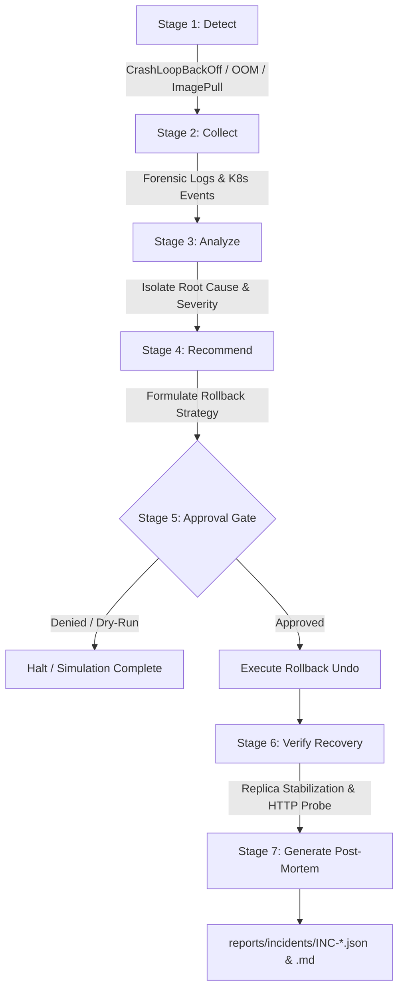

# Python Platform Operations Automation Engine

The Retail Store DevOps platform includes an enterprise-grade Site Reliability Engineering (SRE) automation engine written in Python. It detects microservice failures, audits resource quotas and anomalies, verifies zero-downtime rolling updates, gates and executes safe rollbacks, orchestrates complete incident lifecycles, exports real-time Prometheus telemetry, and generates structured incident post-mortems.

---

## 1. Engine Architecture & Component Layout

```text
automation/
├── ops_cli.py                 # Unified SRE CLI entrypoint for platform operations
├── config/
│   ├── settings.yaml          # Operational thresholds, failure rules, remediation gates
│   └── __init__.py            # ConfigManager with environment variable overrides
├── collectors/                # Kubernetes API telemetry ingestion
│   ├── pod_collector.py       # Container states, exit codes, restart spikes, crash logs
│   ├── node_collector.py      # Node Ready conditions, disk/memory pressure, allocatable
│   ├── resource_collector.py  # CPU & Memory requests/limits normalization and parsing
│   └── event_collector.py     # Cluster and pod warning/error event correlation
├── analyzers/                 # Diagnostic and anomaly detection engines
│   ├── failure_detector.py    # PodFailureDetector: CrashLoop, ImagePull, OOM, Pending
│   ├── resource_analyzer.py   # Capacity exhaustion, missing limit audits, right-sizing
│   └── deployment_analyzer.py # Rollout progression and synthetic HTTP endpoint probing
├── remediation/               # Automated recovery, safety gates & incident lifecycle
│   ├── incident_lifecycle.py  # 7-stage end-to-end incident response lifecycle orchestrator
│   ├── rollback.py            # RollbackManager with preflight checks and dry-run safety
│   └── recovery_validator.py  # Post-rollback replica stabilization and HTTP verification
├── reporting/                 # Operational reporting & telemetry
│   ├── json_report.py         # IncidentReportGenerator producing reports/cluster-diagnostics.json
│   └── metrics.py             # Prometheus metrics exporter (port 9102)
└── tests/
    ├── integration/           # Cluster integration tests (Minikube / kind / live cluster)
    │   ├── conftest.py        # Cluster reachability check & namespace fixture
    │   ├── test_crashloop_integration.py
    │   ├── test_failed_deployment_integration.py
    │   └── test_rollback_recovery_integration.py
    ├── test_collectors.py     # Mocked unit tests
    ├── test_failure_detector.py
    ├── test_analyzers.py
    ├── test_remediation.py
    ├── test_incident_lifecycle.py
    ├── test_reporting.py
    ├── test_ops_cli.py
    ├── test_config.py
    └── test_automation.py
```

---

## 2. End-to-End Automated Incident Lifecycle

The engine provides an automated 7-stage incident response lifecycle (`ops_cli.py incident-lifecycle`):



1. **Detect**: Continuously scans pods and deployments in the target namespace (e.g. failing `cart` pod in `CrashLoopBackOff`).
2. **Collect**: Ingests container stderr tail logs, Kubernetes warning events, termination reasons, and restart counts.
3. **Analyze**: Classifies the failure mode (e.g. `NullPointerException: DB connection failed`), isolates the primary cause, and assigns severity.
4. **Recommend**: Generates an actionable remediation strategy (e.g. roll back deployment `retail-store-cart` to previous revision).
5. **Approval Gate & Execution**: Validates deployment revision history and enforces an approval gate (`--auto-approve` or interactive confirmation).
6. **Verify Recovery**: Polls deployment until all replicas stabilize, verifies no new crashing pods are scheduled, and probes HTTP endpoints.
7. **Report & Post-Mortem**: Generates a structured JSON incident record and a GitHub-flavored Markdown post-mortem document.

---

## 3. Dual-Tier Testing Strategy: Unit vs. Real Integration Tests

The test suite strictly distinguishes **mocked unit tests** from **real cluster integration tests**:

| Test Tier | Location | Execution Context | Purpose |
|---|---|---|---|
| **Tier 1: Unit Tests** | `automation/tests/test_*.py` | Sandboxed Python runner (no K8s cluster required) | Fast validation of parser, collectors, analyzers, remediation logic, and metrics with 100% mocked Kubernetes API responses (**44 passing tests**) |
| **Tier 2: Cluster Integration Tests** | `automation/tests/integration/` | Active Minikube, kind, or Amazon EKS cluster | Validates behavior against real Kubernetes API, real container crashes, live pod events, actual rollbacks, and recovery verification |

### Running Unit Tests:
```bash
pytest -m "not integration" --cov=automation
```

### Running Real Cluster Integration Tests:
```bash
# Launch via helper script (provisions kind cluster automatically if needed):
bash scripts/run_integration_tests.sh

# Or directly via Pytest against an active cluster:
pytest automation/tests/integration -m integration -v
```

---

## 4. Unified SRE CLI Runbook

```bash
# 1. Execute end-to-end incident lifecycle with automated rollback approval
python3 automation/ops_cli.py incident-lifecycle --service cart --auto-approve

# 2. Simulate incident lifecycle in dry-run mode (safe audit)
python3 automation/ops_cli.py incident-lifecycle --service cart --dry-run

# 3. Diagnose cluster health and output terminal table
python3 automation/ops_cli.py diagnose --namespace retail-store

# 4. Audit resource requests, limits, and cluster allocation percentages
python3 automation/ops_cli.py monitor-resources --namespace retail-store

# 5. Verify deployment rollouts and test service endpoints
python3 automation/ops_cli.py verify-deployment --namespace retail-store \
  --service-urls '{"ui":"http://localhost:8888","catalog":"http://localhost:8081/catalog/products"}'

# 6. Execute an authorized live deployment rollback
python3 automation/ops_cli.py rollback --deployment retail-store-cart --confirm

# 7. Start the Prometheus metrics scrape daemon
python3 automation/ops_cli.py export-metrics --port 9102
```

Sample CLI output for `incident-lifecycle`:
```text
============================================================
         AUTOMATED INCIDENT LIFECYCLE ORCHESTRATION         
============================================================
Incident ID:        INC-20261117-132200-cart
Target Service:     Cart
Namespace:          retail-store
Lifecycle Status:   RESOLVED
Duration:           4.82s
------------------------------------------------------------
LIFECYCLE AUDIT TRAIL:
  [FAILURE_CONFIRMED] STAGE_1_DETECTION    Detected failing pod 'retail-store-cart-999-abc'
  [COMPLETED     ] STAGE_2_COLLECTION   Collected 5 events and 182 bytes of log evidence
  [ROOT_CAUSE_ISO] STAGE_3_ANALYSIS     Diagnosed failure: [CRASHLOOPBACKOFF] java.lang.NullPointerException
  [COMPLETED     ] STAGE_4_RECOMMEND    Recommended Action: Roll back deployment 'retail-store-cart'
  [ROLLBACK_APPLI] STAGE_5_EXECUTION    Rollback trigger succeeded: deployment.apps/retail-store-cart rolled back
  [RECOVERED     ] STAGE_6_VERIFICATION Service 'cart' stabilized and healthy! (HTTP 200)
  [REPORT_SAVED  ] STAGE_7_REPORTING    Incident reports generated: reports/incidents/INC-20261117-132200-cart.json

POST-MORTEM ARTIFACTS:
  JSON Record:      reports/incidents/INC-20261117-132200-cart.json
  Markdown Report:  reports/incidents/INC-20261117-132200-cart.md
============================================================
```

---

## 5. Automated CI/CD Testing & Quality Gates

The engine is integrated into GitHub Actions ([`.github/workflows/ci.yml`](../.github/workflows/ci.yml)):
1. **Ruff Linting**: `ruff check automation/`
2. **Unit Testing & Coverage**: `pytest automation/tests -m "not integration" --cov=automation --cov-report=term-missing`
3. **CLI Syntax Verification**: `python automation/ops_cli.py --help`

---

## 6. In-Cluster Daemon Deployment & Prometheus Scraping

The engine can run directly inside Amazon EKS as a self-healing background monitor:

```bash
# 1. Apply RBAC permissions (least-privilege ClusterRole for pod/deployment inspection & rollback)
kubectl apply -f kubernetes/automation/rbac.yaml

# 2. Deploy daemon and metrics service
kubectl apply -f kubernetes/automation/deployment.yaml
kubectl apply -f kubernetes/automation/service.yaml

# 3. Optional: Deploy Prometheus Operator ServiceMonitor
kubectl apply -f kubernetes/automation/service-monitor.yaml
```

The daemon runs `ops_cli.py export-metrics --interval 15`, continuously updating Prometheus metrics:
- `cluster_service_health_status{service="<svc>", namespace="retail-store"}` (1.0 healthy, 0.0 degraded)
- `cluster_pod_restart_count{service="<svc>", pod_name="<pod>"}`
- `automation_checks_total{check_type="daemon_cycle", status="success"}`
- `automation_failures_total{service="<svc>", failure_type="<type>"}`
- `deployment_rollbacks_total{deployment="<dep>", status="<status>"}`
- `automation_execution_seconds{operation="daemon_audit_cycle"}`

