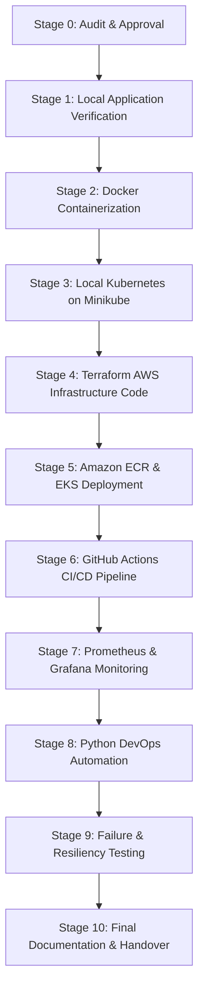

# Source Code Audit & DevOps Implementation Plan
**Application:** AWS Containers Retail Store Sample Application (`aws-containers/retail-store-sample-app`)  
**Date:** November 15, 2026  
**Auditor:** Antigravity Senior DevOps Engineer & Mentor  
**Target Environment:** macOS ARM64 (Apple Silicon M3) / Local Docker / Kubernetes / AWS EKS  

---

## 1. Executive Summary

A comprehensive source code audit was conducted on the cloned repository located at `application/`. The application is an enterprise-grade, cloud-native microservices application originally designed by AWS Containers team to demonstrate containerization, microservice communication, resiliency, and observability.

The application satisfies every requirement of the master implementation prompt:
- **Polyglot microservices:** Built in Java (Spring Boot), Go (Gin), and Node.js (NestJS / TypeScript).
- **Native Observability:** Pre-instrumented with Prometheus metrics endpoints (`/actuator/prometheus` and `/metrics`), health check endpoints (`/actuator/health` and `/health`), and OpenTelemetry tracing.
- **Built-in Resiliency & Chaos Endpoints:** Contains built-in `/chaos` routes in the services (latency injection, HTTP error status code simulation, and health endpoint toggling), which enables hands-on demonstration of Phase 10 (Failure Testing and Recovery).
- **Flexible Persistence Architecture:** Each service supports both in-memory mock mode (zero external database required) and external cloud persistence (MySQL/MariaDB, DynamoDB, Redis, PostgreSQL, RabbitMQ).

---

## 2. Existing Architecture & Services Audit

The application decomposes into distinct services:

| Service | Directory | Language / Framework | Default Port | Persistence Options | Prometheus Endpoint | Health Endpoint |
|---|---|---|---|---|---|---|
| **UI (Storefront)** | `src/ui` | Java 21 / Spring Boot 3.5.16 + Thymeleaf | 8080 (Mapped to 8888) | In-Memory Mocks / HTTP REST to backends | `/actuator/prometheus` | `/actuator/health` |
| **Catalog** | `src/catalog` | Go 1.23+ / Gin Framework | 8080 (Mapped to 8081) | In-Memory / MariaDB / MySQL | `/metrics` | `/health` |
| **Cart** | `src/cart` | Java 21 / Spring Boot 3.5.16 | 8080 (Mapped to 8082) | In-Memory / DynamoDB / DynamoDB-Local | `/actuator/prometheus` | `/actuator/health` |
| **Checkout** | `src/checkout` | Node.js 20 / NestJS 11 + TypeScript | 8080 (Mapped to 8085) | In-Memory / Redis | `/metrics` | `/health` |
| **Orders** | `src/orders` | Java 21 / Spring Boot 3.5.16 | 8080 (Mapped to 8083) | In-Memory / PostgreSQL + RabbitMQ | `/actuator/prometheus` | `/actuator/health` |
| **Load Generator** | `src/load-generator` | Node.js (Artillery / custom runner) | N/A | N/A | N/A | N/A |

### Microservices Interaction Flow

```
                      +-------------------+
                      |   End User /      |
                      |   Web Browser     |
                      +---------+---------+
                                |
                                v
                      +-------------------+
                      |     UI Service    |  <-- Spring Boot 3.5 (Port 8080)
                      +--+-----+-----+----+      Includes /actuator/prometheus
                         |     |     |
          +--------------+     |     +---------------+
          |                    |                     |
          v                    v                     v
+------------------+  +------------------+  +------------------+
|  Catalog Service |  |   Cart Service   |  | Checkout Service |
|  (Go / Gin)      |  |  (Java / Spring) |  | (NestJS / Node)  |
|  Port 8081       |  |   Port 8082      |  |  Port 8085       |
|  /metrics        |  |  /actuator/prom  |  |  /metrics        |
+--------+---------+  +--------+---------+  +--------+---------+
         |                     |                     |
         v                     v                     v
    MySQL / Memory      DynamoDB / Memory     Redis / Memory
                                                     |
                                                     v
                                            +------------------+
                                            |  Orders Service  |
                                            |  (Java / Spring) |
                                            |   Port 8083      |
                                            +--------+---------+
                                                     |
                                                     v
                                            Postgres / RabbitMQ
```

### Key Architectural Discovery: Graceful Degradation
In `src/ui/src/main/java/com/amazon/sample/ui/config/StoreServices.java`, the UI service checks whether backend service URLs (`RETAIL_UI_ENDPOINTS_CATALOG`, `RETAIL_UI_ENDPOINTS_CARTS`, etc.) are configured. If absent or empty, the UI automatically instantiates internal mock services (`MockCatalogService`, `MockCartsService`, `MockCheckoutService`, `MockRecommendationsService`).

This means:
1. The application can run in a **lightweight local mode** where the UI container functions completely self-contained for initial quick sanity testing.
2. The application can run in a **full microservices mode** where each container (UI, Catalog, Cart, Checkout, Orders) communicates over private container networking or Kubernetes cluster DNS (`catalog.retail-store.svc.cluster.local`).

---

## 3. Technology Stack & Build Tools

- **Monorepo Build System:** Nx workspace (`nx.json`), Yarn 4+ (`.yarnrc.yml`).
- **Java Toolchain:** OpenJDK 21, Maven 3.9+ via included Maven Wrapper (`mvnw`).
- **Go Toolchain:** Go 1.23+ with Go Modules (`go.mod`, `go.sum`).
- **Node.js Toolchain:** Node.js 20+, Yarn Berry (`package.json`, `yarn.lock`).
- **Container Base Images:** `public.ecr.aws/amazonlinux/amazonlinux:2023` and `node:20-alpine`.
- **Security Posture in Existing Dockerfiles:**
  * Multi-stage builds.
  * Privilege dropping to non-root user `appuser` (UID 1000).
  * System package updates using `--releasever=latest`.
  * Minimal weak dependencies (`--setopt=install_weak_deps=False`).

---

## 4. Application Configuration & Environment Variables

### UI (`src/ui`)
- `PORT`: HTTP port (default: `8080`).
- `RETAIL_UI_ENDPOINTS_CATALOG`: Catalog API URL (e.g. `http://catalog:8080`).
- `RETAIL_UI_ENDPOINTS_CARTS`: Cart API URL (e.g. `http://cart:8080`).
- `RETAIL_UI_ENDPOINTS_CHECKOUT`: Checkout API URL (e.g. `http://checkout:8080`).
- `RETAIL_UI_ENDPOINTS_ORDERS`: Orders API URL (e.g. `http://orders:8080`).
- `RETAIL_UI_SEARCH_ENABLED`: Set to `false` (explicit exclusion of Elasticsearch/OpenSearch).
- `JAVA_OPTS`: JVM memory flags (e.g. `-XX:MaxRAMPercentage=75.0`).

### Catalog (`src/catalog`)
- `PORT`: HTTP port (default: `8080`).
- `RETAIL_CATALOG_PERSISTENCE_PROVIDER`: `in-memory` or `mysql`.
- `RETAIL_CATALOG_PERSISTENCE_ENDPOINT`: Database host:port (e.g. `catalog-db:3306`).
- `RETAIL_CATALOG_PERSISTENCE_DB_NAME`: Database name (default: `catalogdb`).
- `RETAIL_CATALOG_PERSISTENCE_USER`: DB username.
- `RETAIL_CATALOG_PERSISTENCE_PASSWORD`: DB password.
- `RETAIL_CATALOG_SEARCH_ENABLED`: `false` (disabled per project exclusions).

### Cart (`src/cart`)
- `PORT`: HTTP port (default: `8080`).
- `RETAIL_CART_PERSISTENCE_PROVIDER`: `in-memory` or `dynamodb`.
- `RETAIL_CART_PERSISTENCE_DYNAMODB_ENDPOINT`: DynamoDB endpoint URL.
- `RETAIL_CART_PERSISTENCE_DYNAMODB_CREATE_TABLE`: `true` for local DynamoDB.

### Checkout (`src/checkout`)
- `PORT`: HTTP port (default: `8080`).
- `RETAIL_CHECKOUT_PERSISTENCE_PROVIDER`: `in-memory` or `redis`.
- `RETAIL_CHECKOUT_PERSISTENCE_REDIS_URL`: Redis URL (e.g. `redis://checkout-redis:6379`).
- `ENDPOINTS_ORDERS`: Orders API endpoint (e.g. `http://orders:8080`).

### Orders (`src/orders`)
- `PORT`: HTTP port (default: `8080`).
- `RETAIL_ORDERS_PERSISTENCE_PROVIDER`: `in-memory` or `postgres`.
- `RETAIL_ORDERS_PERSISTENCE_ENDPOINT`: PostgreSQL endpoint.
- `RETAIL_ORDERS_MESSAGING_PROVIDER`: `in-memory` or `rabbitmq`.

---

## 5. Proposed Docker Architecture

1. **Multi-Stage Builds:**
   - Builder stage: compiles code, caches dependencies (`go mod download`, `./mvnw dependency:go-offline`, `yarn install`).
   - Final stage: starts from a clean, minimal runtime base (`amazonlinux:2023` or `alpine`), copies compiled binaries/jars, drops root permissions (`USER appuser`).
2. **Apple Silicon M3 Compatibility:**
   - Build multi-platform images (`linux/arm64` for Apple Silicon local testing, `linux/amd64` for standard AWS EKS managed node groups) using Docker Buildx.
3. **Local Multi-Service Orchestration (`docker-compose.yml`):**
   - Provide clean top-level `docker/docker-compose.yml` orchestrating UI, Catalog, Cart, Checkout, and Orders with optional lightweight backends.
   - Configure health checks for every service using `interval: 10s`, `timeout: 5s`, `retries: 3`.

---

## 6. Proposed Kubernetes Architecture (Local Minikube & EKS)

1. **Namespace:** `retail-store` (dedicated, isolated).
2. **Kubernetes Resources:**
   - **Deployments:**
     * `ui-deployment`: 2 replicas, rolling updates (`maxSurge: 1`, `maxUnavailable: 0`).
     * `catalog-deployment`: 2 replicas.
     * `cart-deployment`: 2 replicas.
     * `checkout-deployment`: 2 replicas.
     * `orders-deployment`: 2 replicas.
   - **Services:**
     * Internal microservices: `ClusterIP` on port 8080.
     * Storefront UI: `NodePort` / `ClusterIP` locally (port-forward or Minikube service), and AWS Network Load Balancer / Application Load Balancer on Amazon EKS.
   - **Configuration & Secrets:**
     * `ConfigMap`: Application endpoints, JVM parameters, feature toggles.
     * `Secret`: Database credentials and AWS configuration keys.
   - **Reliability & Scaling:**
     * Readiness Probes: HTTP GET on `/actuator/health` or `/health`.
     * Liveness Probes: HTTP GET on `/actuator/health` or `/health`.
     * Resource Requests & Limits: Defined for every container (e.g. UI: requests 250m CPU / 512Mi RAM; limits 500m CPU / 1Gi RAM).
     * Horizontal Pod Autoscaler (HPA): Auto-scales pods when CPU exceeds 70%.

---

## 7. Risks, Host Dependencies & Mitigation Plan

### Host Tooling Audit
During our environment inspection on the MacBook Air M3, the following tool status was identified:
- **Available:** Python 3.12 (`python3`, `pip`), Node.js 24 (`node`, `npm`), Go 1.27 (`go`), OpenJDK 11 (`java`), Helm (`helm`), Minikube (`minikube`), Kind (`kind`).
- **Missing / Needs Setup:**
  * `docker` CLI & daemon: Not in active PATH. We will guide installing Docker Desktop or Colima (`brew install colima docker`).
  * `kubectl`: Not currently linked (`brew install kubectl`).
  * `terraform`: Not currently installed (`brew install terraform`).
  * `aws`: AWS CLI not installed (`brew install awscli`).
  * `trivy`: Security scanner not installed (`brew install trivy`).
  * Python tools: `pytest` and `ruff` will be installed in a clean virtual environment (`python3 -m venv .venv`).

### Policy & Exclusions Compliance
- **Elasticsearch / OpenSearch:** Excluded. We set `SEARCH_ENABLED=false` across all configurations.
- **Argo CD & Jenkins:** Excluded. Deployments use native `kubectl` rolling updates and GitHub Actions workflows.
- **Node Exporter:** Excluded initially. Metrics will be gathered via application Prometheus endpoints and Kubernetes metrics-server / kube-state-metrics.
- **AWS Cost Safety:** 100% of testing will run locally on Minikube first. No AWS infrastructure will be applied without prior plan review and explicit confirmation.

---

## 8. Complete Step-by-Step Implementation Roadmap



- **Stage 0 (Current):** Source code audit, architecture mapping, and implementation roadmap. (Awaiting user approval).
- **Stage 1:** Verify local application execution (UI and core microservices), test pages and endpoints.
- **Stage 2:** Multi-stage Docker builds, `.dockerignore`, `docker-compose.yml`, and local container testing.
- **Stage 3:** Local Kubernetes manifests (`kubernetes/`), namespace, deployments, services, ConfigMaps, readiness/liveness probes, Minikube testing.
- **Stage 4:** Terraform modular infrastructure (`terraform/modules/{networking,iam,ecr,eks}`), cost calculation, validation and plan.
- **Stage 5:** Amazon ECR setup, image pushing with immutable semantic/git SHA tags, EKS cluster connectivity and deployment.
- **Stage 6:** GitHub Actions workflows (`.github/workflows/ci.yml`, `security.yml` with Trivy, `deploy.yml` with AWS OIDC).
- **Stage 7:** Prometheus metrics collection via Helm, Grafana dashboards (`monitoring/grafana/dashboards/`).
- **Stage 8:** Python DevOps operational automation scripts (`automation/`) with unit tests in Pytest.
- **Stage 9:** Controlled failure simulation (pod deletion, crash backoff, invalid image tag, rolling update, rollback) using the built-in `/chaos` endpoints and kubectl.
- **Stage 10:** Comprehensive production documentation, architecture diagrams, and cleanup guide.
