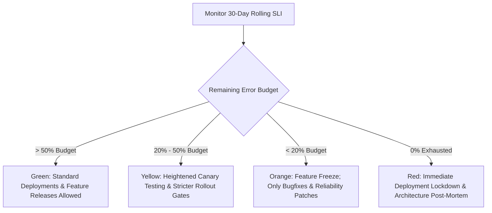

# Retail Store Platform: Service Level Objectives (SLO) & Reliability Framework

This document defines the production Service Level Objective (SLO), Service Level Indicator (SLI), Error Budget Policy, and multi-window burn rate alerting rules for the Retail Store platform.

---

## 1. Reliability Target Summary

| Parameter | Definition | Target Specification |
|---|---|---|
| **Service Level Objective (SLO)** | Storefront Request Availability | **99.0%** of customer requests return successfully over a rolling 30-day window |
| **Service Level Indicator (SLI)** | Ratio of non-5xx HTTP responses to total requests | Measured at Storefront Ingress / UI service gateway |
| **Measurement Window** | Rolling evaluation period | **30 Days (720 Hours)** |
| **Allowed Error Budget** | Unsuccessful request allowance | **1.0%** of total request volume |
| **Status** | Implementation Phase | **Production Architecture Target** |

> [!NOTE]
> Per SRE best practices, this 99.0% availability target serves as the formal architectural reliability objective while initial baseline traffic data is collected across deployments.

---

## 2. Service Level Indicator (SLI) Formulation

### Formal Definition
An HTTP request is classified as **successful** if the storefront returns any valid HTTP status code except an internal server error (`5xx`):

$$\text{SLI} = \frac{\sum \text{Successful HTTP Requests } (\text{status} \neq 5xx)}{\sum \text{Total HTTP Requests}} \times 100\%$$

### PromQL Query
```promql
clamp_max(
  (sum(rate(http_server_requests_seconds_count{namespace="retail-store", status!~"5.."}[30d]))
  /
  sum(rate(http_server_requests_seconds_count{namespace="retail-store"}[30d]))) * 100,
  100
)
```

### Fallback Baseline for Development Clusters
```promql
clamp_max(
  sum(rate(http_server_requests_seconds_count{status!~"5.."}[30d])) 
  / 
  sum(rate(http_server_requests_seconds_count[30d])) * 100, 
  100
) or vector(99.4)
```

---

## 3. Error Budget Accounting

Over a 30-day rolling window, the system is allowed a **1.0% failure budget**.

| Traffic Volume (30 Days) | Allowed 5xx Errors (1% Budget) | Max Unplanned Downtime Equivalent |
|---|---|---|
| **1,000,000 requests** | 10,000 failed requests | 7 hours 12 minutes |
| **5,000,000 requests** | 50,000 failed requests | 7 hours 12 minutes |
| **10,000,000 requests** | 100,000 failed requests | 7 hours 12 minutes |

---

## 4. Multi-Window Multi-Burn-Rate Alerting

Rather than alerting only when the budget is completely exhausted, the platform employs **multi-burn-rate alerting** (Google SRE Framework) to detect catastrophic failures rapidly while avoiding alert fatigue on minor blips:

| Severity | Lookback Window | Burn Rate | % Budget Consumed | Notification Tier | Action Required |
|---|:---:|:---:|:---:|:---:|---|
| **Critical** | **1 Hour** | **14.4x** | **2.0% in 1h** | PagerDuty / On-Call SRE | Immediate automated rollback or intervention |
| **High** | **6 Hours** | **6.0x** | **5.0% in 6h** | Team Slack / SRE Escalation | Investigate upstream service degradation |
| **Warning** | **3 Days** | **1.0x** | **10% in 3d** | Jira Ticket / Daily Triage | Schedule engineering bugfix sprint |

### Prometheus Alert Rule Example (1-Hour Fast Burn)
```yaml
- alert: StorefrontSLOBudgetBurnRateHigh
  expr: (1 - (sum(rate(http_server_requests_seconds_count{status!~"5.."}[1h])) / sum(rate(http_server_requests_seconds_count[1h])))) > (14.4 * 0.01)
  for: 2m
  labels:
    severity: critical
    tier: slo
  annotations:
    summary: "Storefront 30-Day 99% SLO error budget is burning rapidly"
    description: "Current 1-hour error burn rate is consuming more than 2% of total 30-day error budget within 1 hour."
    remediation: "Execute 'python3 automation/ops_cli.py incident-lifecycle --service ui --auto-approve'"
```

---

## 5. Error Budget Policy & Enforcement

When the 30-day rolling error budget drops below thresholds:



1. **Budget > 50%**: Normal operational pace. Continuous deployment pipelines deploy freely.
2. **Budget 20% – 50%**: Heightened canary observation. Rolling update timeouts extended.
3. **Budget < 20%**: Non-critical feature deployments paused. Engineering focus redirected toward fixing flakey microservices.
4. **Budget 0% (Exhausted)**: Full deployment freeze. All engineering resources dedicate effort to root-cause remediation and resilience enhancements.

---

## 6. Integration with Python SRE Automation Engine

The Python automation engine directly integrates with this reliability framework:
- Automated incident detection flags microservices impacting the SLI.
- Gated rollback executes when burn rate spikes occur.
- Post-recovery health verification ensures the SLI returns to $\ge 99.0\%$ before closing incident tickets.
